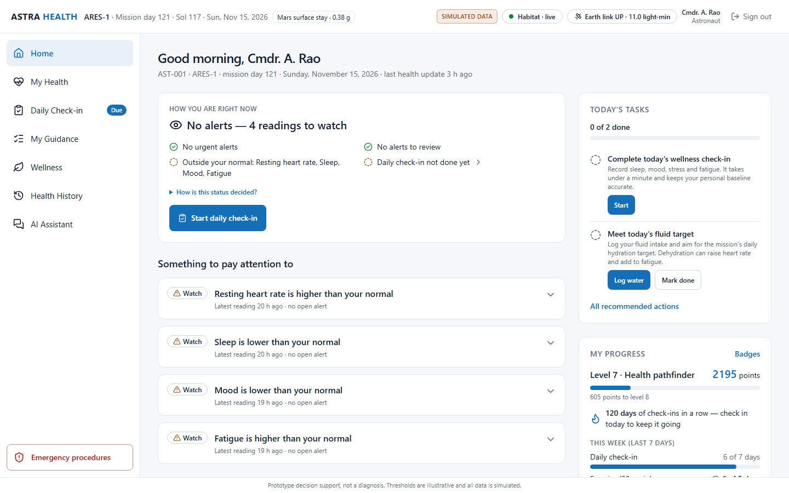
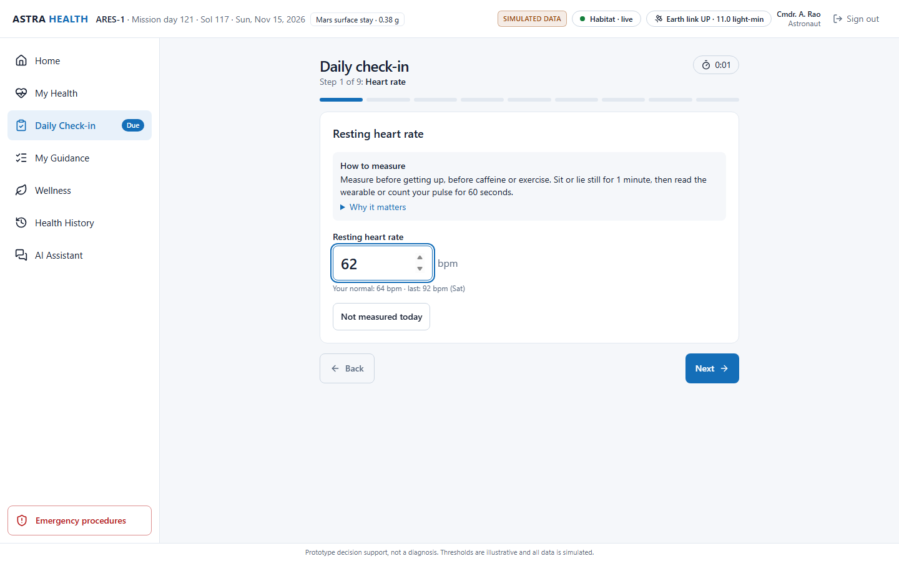
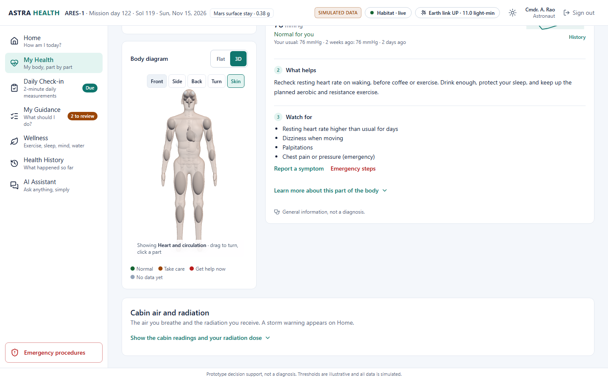
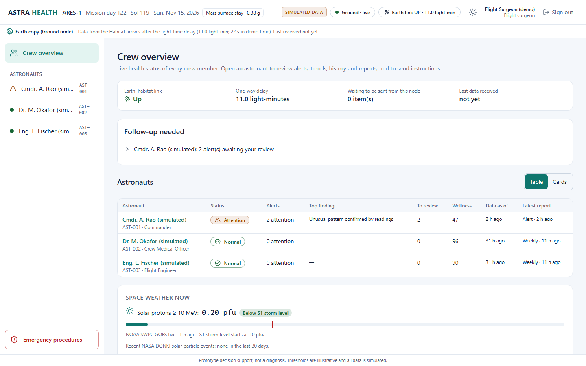
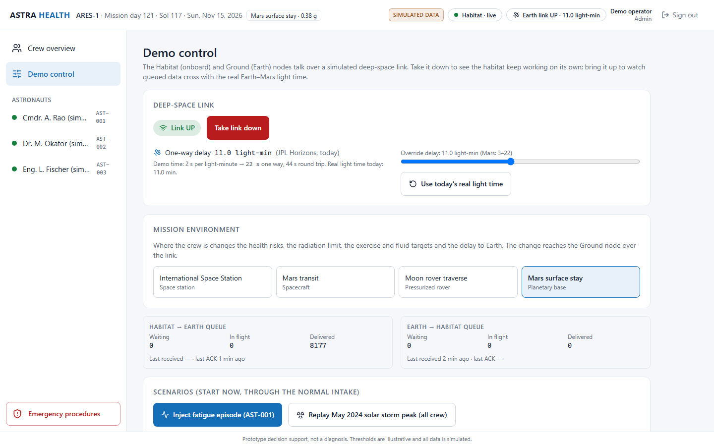
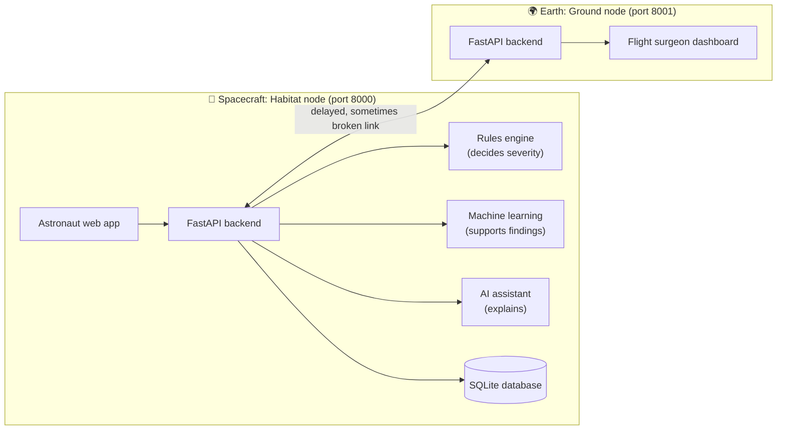
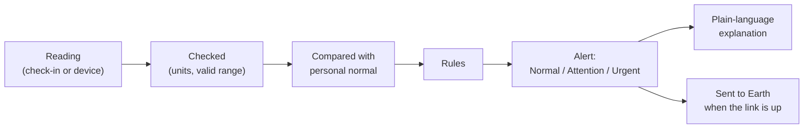
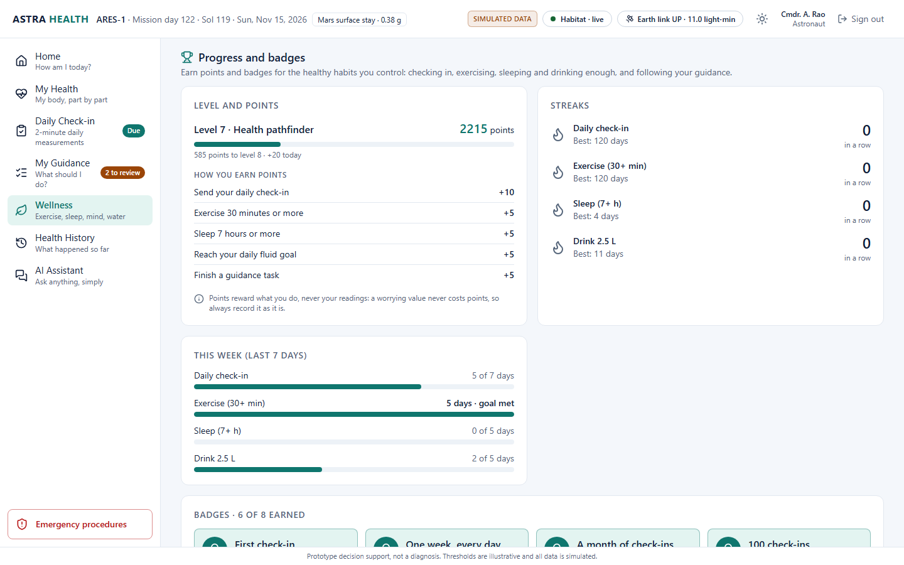
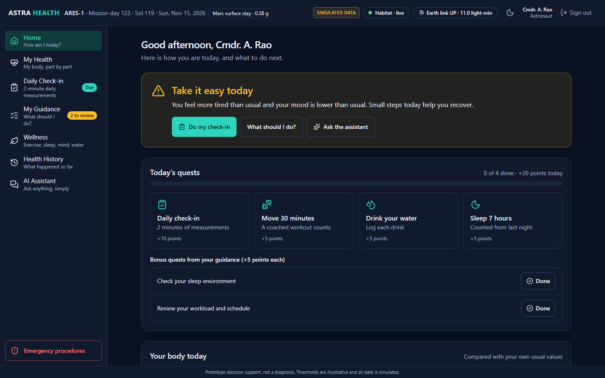
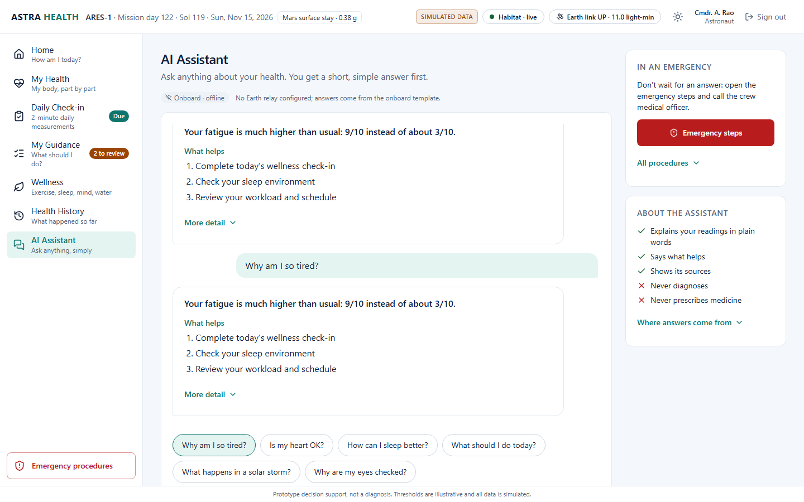

<div align="center">

# ASTRA HEALTH

**Health monitoring and decision support for astronauts on long space missions**

Turns daily health measurements into clear, explained guidance that works onboard, with no internet,<br>
and sends reports to flight surgeons on Earth when the link allows.


</div>

> [!WARNING]
> **This is not a medical device.** ASTRA HEALTH is a hackathon research prototype for clinical *decision support*. It does not diagnose or prescribe. All thresholds are **illustrative** and all crew health data is **simulated**.

<p align="center">
  
</p>

| Daily check-in | My Health: 3D body |
|---|---|
|  |  |
| **Flight surgeon on Earth** | **Demo control** |
|  |  |

---

## Contents

1. [What is ASTRA HEALTH?](#1-what-is-astra-health)
2. [How it works](#2-how-it-works)
3. [Quick start](#3-quick-start)
4. [Using the app](#4-using-the-app)
5. [Configuration](#5-configuration)
6. [Tests and quality checks](#6-tests-and-quality-checks)
7. [Results](#7-results)
8. [Project structure](#8-project-structure)
9. [Documentation](#9-documentation)
10. [Data and sources](#10-data-and-sources)
11. [Troubleshooting](#11-troubleshooting)
12. [Contributing](#12-contributing)

---

## 1. What is ASTRA HEALTH?

On a mission to Mars, a message to Earth can take up to 22 minutes each way, and sometimes there is no connection at all. Astronauts need to understand their own health **onboard**, without waiting for a doctor on Earth.

ASTRA HEALTH helps with that in three ways:

| | What it does |
|---|---|
| 🩺 **Tracks health** | Heart rate, blood pressure, temperature, oxygen, sleep, mood, stress, symptoms, activity and radiation, from a 2-minute daily check-in and wearable devices. |
| 📊 **Compares with *your* normal** | Each reading is compared with the astronaut's own normal, not a population average, and changes are explained in plain language. |
| 🚦 **Raises clear alerts** | **Normal**, **Attention** or **Urgent**. Each alert says what changed, why it matters, what to do and when to get medical help. |

It has two sides:

- **Astronaut app** (on the spacecraft): home summary, guided daily check-in, body systems, trends, guidance, wellness, health history, an AI assistant and offline emergency procedures.
- **Flight surgeon dashboard** (on Earth): crew overview, communication status, follow-ups, alerts, reports and secure instructions back to the crew.

### Safety by design

| Part | Its only job |
|---|---|
| **Rules engine** | Decides how serious something is, using fixed, versioned and testable rules. |
| **Machine learning** | Only *supports* a finding (anomaly and trend detection). It never raises an Urgent alert on its own. |
| **AI assistant** | Only *explains*, citing NASA and CSA sources. It never diagnoses, prescribes or overrides an alert. Emergency symptoms skip the AI and go straight to the emergency steps. |

---

## 2. How it works

The same backend runs in two places: the **Habitat node** on the spacecraft and the **Ground node** on Earth.



**What happens to a single reading:**



### Tech stack

| Area | Technology |
|---|---|
| **Frontend** | React 19, Vite, TypeScript, Tailwind CSS 4, TanStack Query, Recharts, three.js (3D body model), MediaPipe Pose (on-device body tracking for the exercise coach, Apache-2.0), Dexie (offline queue), installable PWA |
| **Backend** | Python 3.12, FastAPI, SQLModel + SQLite, WebSockets |
| **Machine learning** | scikit-learn (Isolation Forest anomaly detection) and trend tests. Runs inside the backend, so there is nothing extra to start. |
| **AI assistant** | Claude (Anthropic API), with Ollama or offline template answers as fallbacks |
| **Testing** | pytest, ruff, mypy (strict), Playwright, axe accessibility scans |

---

## 3. Quick start

> [!NOTE]
> Commands are written for **Windows PowerShell** and run from the project root. On macOS or Linux, replace `.venv/Scripts/python` with `.venv/bin/python`.

> [!TIP]
> **Already installed (steps 1–3)? Start everything with one command:**
> ```powershell
> .\start-demo.ps1
> ```
> It creates the databases the first time, opens a window each for the Habitat backend, the Ground backend and the web app, loads the mission data and opens the browser (about 75 s the first time, a few seconds after that).
> - `.\start-demo.ps1 -Fresh`: start over from mission day 121. **Run this on the morning of a demo**, since the mission day moves on each day and rehearsal check-ins stay in the database.
> - `.\start-demo.ps1 -Stop`: close everything it started.
> - Ports busy? `.\start-demo.ps1 -HabitatPort 8100 -GroundPort 8101 -WebPort 5180`
> - If Windows blocks the script, run `Set-ExecutionPolicy -Scope CurrentUser RemoteSigned` once.
>
> Steps 4–6 below do the same by hand.

### Step 1: Install the prerequisites

| Tool | Version | Get it |
|---|---|---|
| Python | 3.12 | installed through **uv** (below) |
| uv | latest | https://docs.astral.sh/uv/ |
| Node.js | 22 or newer | https://nodejs.org/ |
| Git | any | https://git-scm.com/ |

### Step 2: Install the project

```bash
git clone https://github.com/Tarun9076/Astra-Health.git
```
```bash
cd Astra-Health/services/backend; uv venv --python 3.12 .venv; uv pip install --python .venv/Scripts/python.exe -e ".[dev]"
```
```bash
cd apps/web; npm install
```

### Step 3: Add your settings (optional)

The app works **without any keys**: it uses cached space data and offline assistant answers. To enable everything, create the settings file:

```bash
cd services/backend; cp .env.example .env
```

Then open `services/backend/.env` and fill in:

| Setting | What it is | Required? |
|---|---|---|
| `ASTRA_JWT_SECRET` | Random secret for login tokens. Generate one with `python -c "import secrets; print(secrets.token_urlsafe(48))"` | Recommended |
| `ASTRA_NASA_API_KEY` | Free key from https://api.nasa.gov/ for live solar-storm data | Optional |
| `ANTHROPIC_API_KEY` | Enables Claude for the AI assistant | Optional |
| `GEMINI_API_KEY` | Enables Google Gemini for the AI assistant instead (free key from aistudio.google.com) | Optional |

> [!CAUTION]
> `.env` holds secrets. It is git-ignored, so never commit it.

### Step 4: Create the demo databases

This creates the mission, 3 astronauts and the demo accounts. It only needs to run **once**.

```bash
cd services/backend; .venv/Scripts/python -m astra.seed --mission-day-today 121
```
```bash
cd services/backend; $env:ASTRA_DATABASE_URL = 'sqlite:///ground.db'; .venv/Scripts/python -m astra.seed --mission-day-today 121
```

Run the second command in its own terminal so the `$env:` setting doesn't carry over to the others.

### Step 5: Start the app

Open **three terminals**, one for each part:

**Terminal 1: Habitat backend (spacecraft), http://localhost:8000**
```bash
cd services/backend; .venv/Scripts/python -m uvicorn astra.main:app --reload --port 8000
```

**Terminal 2: Ground backend (Earth), http://localhost:8001.** Only needed for the flight surgeon side.
```bash
cd services/backend; $env:ASTRA_NODE_ROLE = 'Ground'; $env:ASTRA_NODE_ID = 'GND-MCC'; $env:ASTRA_DATABASE_URL = 'sqlite:///ground.db'; $env:ASTRA_PEER_URL = 'http://localhost:8000'; .venv/Scripts/python -m uvicorn astra.main:app --port 8001
```

**Terminal 3: Web app, http://localhost:5173**
```bash
cd apps/web; npm run dev
```

### Step 6: Load the simulated mission data

With the backends running, load 150 days of crew data: about 6,600 readings, including a replay of the real May 2024 solar storm. It is safe to run again, because duplicates are skipped.

```bash
services/backend/.venv/Scripts/python simulator/simulate.py seed
```

History is loaded up to yesterday, so **today's check-in raises alerts live**. The data reaches the Ground node automatically over the simulated link.

### Step 7: Sign in

Open **http://localhost:5173** and use one of the demo accounts:

| Username | Password | Role |
|---|---|---|
| `ast1` | `astra-demo-ast1` | Astronaut (AST-001) |
| `ast2` | `astra-demo-ast2` | Astronaut (AST-002) |
| `ast3` | `astra-demo-ast3` | Astronaut (AST-003) |
| `surgeon1` | `astra-demo-surgeon` | Flight surgeon |
| `mission1` | `astra-demo-mission` | Mission control |
| `admin` | `astra-demo-admin` | Demo operator: link up or down, delay, scenarios |

> [!IMPORTANT]
> These accounts are for **local demos only**. They come from `services/backend/seed.example.json`. For anything shared, put your own accounts in a git-ignored `seed.local.json`.

**Try this first:** sign in as `ast1` and press **Start daily check-in**. Enter little sleep, high fatigue and a high resting heart rate, and watch the fatigue alerts appear with full explanations.

---

## 4. Using the app

### Astronaut side

The menu is organised by **what you want to do**:

| Section | What it is for |
|---|---|
| **Home** | *How am I today?* One sentence (OK, Take care, or Get help now) with the one thing to do, today's quests with points, your body at a glance in words, your level and streak |
| **My Health** | A human body figure (flat or 3D: turn it, zoom, click an organ) and body systems (what each does, how spaceflight affects it, your readings, symptoms to watch for), plus trends and charts |
| **Daily Check-in** | Guided measurements in about 2 minutes: heart rate, blood pressure, temperature, oxygen, blood sugar, body mass, sleep, mood, stress and symptoms, with how-to steps, units and validation. You can add photos (skin, eye, wound, a device display) for the flight surgeon |
| **My Guidance** | *What should I do?* Short action cards (why, when, Mark as done +5 points), plus every health alert in plain words |
| **Wellness** | Physical activity with the **exercise coach**, sleep, mental wellness (breathing, support), nutrition and hydration, plus **progress and badges** |
| **Health History** | Timeline of everything recorded, plus medical reports |
| **AI Assistant** | A short answer first (one or two sentences), up to 3 steps that help, and when to get help; the explanation and sources are one tap away. It never diagnoses or prescribes. |
| **Emergency procedures** | Always at the bottom of the menu, and stored in the app so it works offline |

Home also shows **My progress** (points, check-in streak, this week's goals) and **Your environment** (gravity, delay to Earth, what matters most for your health there).

**Exercise coach** (Wellness → *Start a coached workout*): today's resistance plan (squats, deadlifts, heel raises), adjusted to your condition: a rest day with a fever or an urgent alert, a lighter plan when you are tired, extra sets when strength is falling, with the reason shown. Stand side-on to the laptop camera, 2–3 m away: the coach counts reps and sets, gives posture tips out loud ("keep your chest up", "go a little lower"), times your rests and saves the result, which also reaches the flight surgeon. **The video never leaves the device**; only counts and form scores are saved. No camera, or rehearsing? Use **Demo playback**: a simulated person does the plan, with a few deliberate mistakes, saved as simulated data. It is coaching, not a medical device.

Points reward what you *do* (check in, exercise, sleep and drink enough, finish guidance tasks), never your readings, so a worrying value never costs points.



Design principles: every page answers its own question first, in everyday words (no statistics jargon); the numbers, sources and how a rule decided are one tap away under **More detail**. Three levels everywhere: **OK**, **Take care**, **Get help now**, never shown by colour alone (always an icon and a word). Missing data is never shown as normal.

**Connect your smartwatch:** any watch or chest strap that offers the standard Bluetooth heart-rate signal works (tested design: Fire-Boltt BGR002). Use **Chrome or Edge** on a laptop with Bluetooth, at `http://localhost:5173`:
1. Turn off Bluetooth on your phone for now (the watch talks to one device at a time), and wear the watch snugly.
2. Sign in as an astronaut and click **Connect watch** at the top. Pick your watch in the list and click **Pair**.
3. The top bar shows your live heart rate. One reading a minute is saved to your health record (source: your watch). In the daily check-in, **Measure with my watch (30 s)** fills in your resting heart rate; the exercise coach shows your heart rate while you train.

Only heart rate is read from the watch: blood oxygen, sleep and steps on most budget watches use the maker's private format.

**Light and dark themes:** *Calm light* by default and *Mission dark* for dim cabins. Switch with the sun/moon button in the header; the choice is remembered on that device (until then the app follows the device setting).





### Flight surgeon side

Sign in as `surgeon1`. The surgeon gets:
- a **crew overview** with communication status, a "Follow-up needed" list and a crew table;
- for each astronaut, tabs for Summary, Body, Alerts review, Trends, Health history, Reports, Exercise (coached sessions: reps, form, tips) and Instructions (messages sent back to the crew).

### Admin (demo control)

Sign in as `admin` to switch the Earth link up or down, change the light-time delay and run scenarios live.

You can also switch the **mission environment**. Each one changes the targets, the radiation limit, the delay to Earth and the health advice:

| Environment | Gravity | Delay to Earth |
|---|---|---|
| International Space Station | weightless | under a second |
| Mars transit (spacecraft) | weightless | 3–22 minutes |
| Moon rover traverse | 0.17 g | about 1.5 seconds |
| Mars surface stay (default) | 0.38 g | 3–22 minutes |

### API documentation

Interactive API docs (Swagger) are at **http://localhost:8000/docs**. To try a protected endpoint:
1. Call `POST /api/auth/login`.
2. Copy the `accessToken`.
3. Click **Authorize** and paste it.
4. Try `GET /api/astronauts/AST-001/dashboard`.

---

## 5. Configuration

All settings live in `services/backend/.env`. The full list is in [LLD §18](docs/03-Low-Level-Design.md).

| Setting | Default | Meaning |
|---|---|---|
| `ASTRA_NODE_ROLE` | `Habitat` | `Habitat` (spacecraft) or `Ground` (Earth) |
| `ASTRA_NODE_ID` | `HAB-ARES-1` | Name of this node |
| `ASTRA_PEER_URL` | `http://localhost:8001` | Address of the other node |
| `ASTRA_SYNC_KEY` | dev value | Shared secret that signs messages between nodes. Use the same random value on both. |
| `ASTRA_DATABASE_URL` | `sqlite:///habitat.db` | Database file |
| `ASTRA_JWT_SECRET` | none | Secret for login tokens |
| `ASTRA_LLM_PROVIDER` | `auto` | `auto` (Claude if its key is set, else Gemini, else offline), `claude`, `gemini` or `template` (offline) |
| `ASTRA_LLM_MODEL` | `claude-opus-5-5` | Claude model for the assistant |
| `ANTHROPIC_API_KEY` | none | Enables Claude |
| `GEMINI_API_KEY` | none | Enables Gemini |
| `ASTRA_GEMINI_MODEL` | `gemini-3.8-flash` | Gemini model for the assistant |
| `ASTRA_NASA_API_KEY` | none | Enables live NASA DONKI solar-storm data |

**Changed a backend endpoint?** Regenerate the web app's API types:

```bash
cd services/backend; .venv/Scripts/python -m astra.export_openapi ../../apps/web/openapi.json
```
```bash
cd apps/web; npm run gen:api
```

---

## Deploying online

The web app goes on **Vercel**; the two backends run on one **Google Cloud** VM with Docker and automatic
HTTPS (Vercel can't run always-on servers). Step-by-step guide: **[deploy/README.md](deploy/README.md)**
(about 30–45 minutes; no domain needed).

---

## 6. Tests and quality checks

| Check | Command |
|---|---|
| Backend tests | `cd services/backend; .venv/Scripts/python -m pytest` |
| Lint and types (backend) | `cd services/backend; .venv/Scripts/python -m ruff check astra tests; .venv/Scripts/python -m mypy` |
| Lint (web) | `cd apps/web; npm run lint` |
| Exercise coach engine (web) | `cd apps/web; npm run test:unit` |
| Type check and build (web) | `cd apps/web; npm run build` |
| Browser tests and accessibility | `cd apps/web; npm run e2e` |
| Prototype metrics | `cd services/backend; .venv/Scripts/python -m astra.evaluate` |

**Browser tests:** install the browser once with `npx playwright install chromium`. If port 5174 is busy, set another one first, e.g. `$env:ASTRA_E2E_WEB_PORT = '5175'`. The tests start their own backend (port 8100, fresh database) and web app (port 5174), so your running demo is not touched. They also run **axe accessibility scans** on every page.

**Prototype metrics** replays the simulated missions and writes [docs/evaluation/EVALUATION.md](docs/evaluation/EVALUATION.md).

---

## 7. Results

From [the evaluation report](docs/evaluation/EVALUATION.md). These come from **simulated data**: they measure how the prototype works, not clinical performance.

| What was tested | Result |
|---|---|
| Fatigue episode (injected on day 114) | Detected in 2 days; the AI trend note came after 1 day |
| Real May 2024 solar storm replay | Urgent radiation alert for 3 of 3 crew, the same day |
| Faulty sensor reading (heart rate 190, weak signal) | Marked "questionable"; correctly **no** alarm |
| False alarms on healthy crew | At most 2 Attention and 0 Urgent per astronaut over the mission |
| API speed (150 days × 3 crew) | About 50 ms median for most screens |
| Daily check-in in the browser | Completed in 38 s |
| Spacecraft-to-Earth sync | Every item delivered exactly once, even over a broken link |

---

## 8. Project structure

```
Astra-Health/
├── apps/web/            React web app (astronaut, flight surgeon, mission control, admin)
│   ├── src/features/    One folder per screen (home, check-in, body, exercise, guidance, history…)
│   ├── public/models/   Body-tracking model for the exercise coach (served locally, works offline)
│   ├── unit/            Exercise coach engine tests (Node test runner)
│   └── e2e/             Playwright browser and accessibility tests
├── services/backend/    Python FastAPI backend (package "astra")
│   ├── astra/core/      Pure logic: baselines, rules, validation (no web or database code)
│   ├── astra/api/       HTTP endpoints
│   ├── astra/ml/        Anomaly and trend detection
│   ├── astra/assistant/ AI assistant (retrieval, providers, red-flag safety bypass)
│   ├── astra/sync/      Habitat ↔ Ground sync over the simulated deep-space link
│   └── tests/           Backend tests
├── simulator/           Simulated crew data generator, plus cached real space data
├── protocols/           Indicators, versioned alert rules, recommendations, emergency procedures
├── knowledge/           Knowledge base used by the assistant (NASA / CSA sourced)
├── docs/                Design documents (Markdown, PDFs in docs/pdf/, screenshots in docs/screenshots/)
├── tools/docs-pdf/      Regenerates the PDFs
├── deploy/              Docker images, Caddy (HTTPS) and the Vercel + Google Cloud guide
└── start-demo.ps1       Starts the whole demo with one command
```

---

## 9. Documentation

New here? Read them in this order. Start with [docs/README.md](docs/README.md) for a one-page overview.

| # | Document | Read it to learn |
|---|---|---|
| 1 | [Technical Design Document](docs/01-Technical-Design-Document.md) | **Why**: goals, requirements, key decisions, AI safety rules, risks |
| 2 | [High-Level Design](docs/02-High-Level-Design.md) | **What**: the big picture, the two nodes, components, data flows, screen map |
| 3 | [Low-Level Design](docs/03-Low-Level-Design.md) | **How**: database, algorithms, alert rules, API, UI design system, test cases |
| 4 | [Implementation Plan](docs/04-Implementation-Plan.md) | **When**: build steps, milestones, demo script |
| 📈 | [Evaluation](docs/evaluation/EVALUATION.md) | Measured results of the prototype |

📄 **PDF versions** are in [docs/pdf/](docs/pdf/). `ASTRA-HEALTH-Design-Docs.pdf` has everything in one file. After editing any document, regenerate them:

```bash
cd tools/docs-pdf; npm install; npm run pdf
```

---

## 10. Data and sources

**Crew health data is simulated**, because real astronaut medical data is not public. The simulator is calibrated with published spaceflight values.

**Space environment data is real:**
- NASA DONKI solar-particle events (needs the NASA key)
- JPL Horizons Earth–Mars light time (no key)
- NOAA SWPC proton flux (no key)

Responses are cached in `simulator/fixtures/`, so the demo works offline. Details: [LLD §20](docs/03-Low-Level-Design.md).

**Hackathon-provided sources:**
- NASA HRP: [5 Hazards of Human Spaceflight](https://www.nasa.gov/hrp/hazards/)
- NASA HRP: [Risks of Human Spaceflight](http://nasa.gov/hrp/risks/)
- NASA HRP: [Ongoing HRP Research](https://www.nasa.gov/hrp/ongoing-hrp-research/)
- CSA: [Monitoring radiation for astronaut health](https://www.asc-csa.gc.ca/eng/news/articles/2026/2026-02-26-monitoring-radiation-astronaut-health.asp)
- CSA: [Why do we conduct science experiments in space?](https://www.asc-csa.gc.ca/eng/iss/science/why-do-we-conduct-science-experiments-in-space.asp)

**Supporting sources:** [NASA Human Research Roadmap](https://humanresearchroadmap.nasa.gov/) · [NASA-STD-3001](https://www.nasa.gov/ocho/std-3001/)

---

## 11. Troubleshooting

| Problem | Fix |
|---|---|
| `address already in use` / port busy | Something is already running on that port (8000, 8001 or 5173). Stop it with **Ctrl+C** in its terminal, or close the old terminal. `start-demo.ps1` says which program holds the port, and reuses it if it is already the demo. |
| `start-demo.ps1 cannot be loaded because running scripts is disabled` | Run `Set-ExecutionPolicy -Scope CurrentUser RemoteSigned` once, then try again. |
| Mission day or dates look wrong, or yesterday's rehearsal check-ins are still there | `.\start-demo.ps1 -Fresh` (it resets the databases to mission day 121 and today's date). |
| `The token '&&' is not a valid statement separator` | Windows PowerShell 5.1 doesn't support `&&`. Use `;` instead, as in the commands above. |
| Flight surgeon sees no data | Start the **Ground** backend (Terminal 2), then check the link is up on the admin **Demo control** page. |
| Flight surgeon doesn't see new photos or the new environment | Restart the **Ground** backend (Terminal 2) after pulling new code if you started it by hand without `--reload` (`start-demo.ps1` starts it with `--reload`). |
| Errors after pulling new code that changed the database tables | There are no migrations yet. Stop both backends, delete `services/backend/habitat.db*` and `ground.db*`, then repeat [Step 4](#step-4-create-the-demo-databases) and [Step 6](#step-6-load-the-simulated-mission-data). |
| Web app shows "API types" errors after a backend change | Regenerate the types (see [Configuration](#5-configuration)). |
| Smartwatch: "Could not connect" or the watch is not in the list | Turn off Bluetooth on your phone (or close the watch's app), keep the watch close to the laptop and try again. Use Chrome or Edge at `localhost` (Bluetooth does not work over plain http on another address). Your watch must offer the standard heart-rate signal: check with the free nRF Connect app. |
| Exercise coach: camera message, or no reps counted | Allow the camera in the browser's address bar (it works on `localhost` or https). Stand side-on, 2–3 m away, with your whole body, head to feet, in the picture and good light. Use **Demo playback** to show the feature without a camera. |
| AI assistant gives short, generic answers | No `ANTHROPIC_API_KEY` or `GEMINI_API_KEY` is set, so it uses offline template answers. This is expected. Restart the Habitat backend after adding a key. |
| `uv` says Python 3.12 not found | Run `uv python install 3.12`, then repeat Step 2. |

---

## 12. Contributing

1. Create a branch from `main`.
2. Make your change and run the [checks](#6-tests-and-quality-checks). All must pass.
3. Commit with a [Conventional Commits](https://www.conventionalcommits.org/) message, for example:
   - `feat(web): add sleep chart`
   - `fix(api): reject negative heart rate`
   - `docs: update setup steps`
   - `test(e2e): cover offline check-in`
4. If you changed a design document, regenerate the PDFs.
5. Open a pull request.

**Project rules:**
- Rules decide severity, ML only supports, the AI only explains.
- `astra/core` must stay free of web, database and network code.
- Never commit `.env` or real keys.
- Keep the "simulated / illustrative / not a diagnosis" wording in every feature.

---

<div align="center">

Built for a NASA-themed hackathon · **Simulated data · Not a medical device**

</div>
