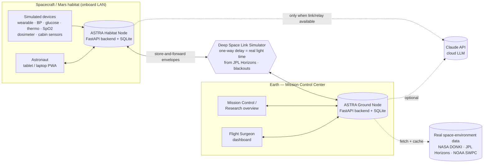
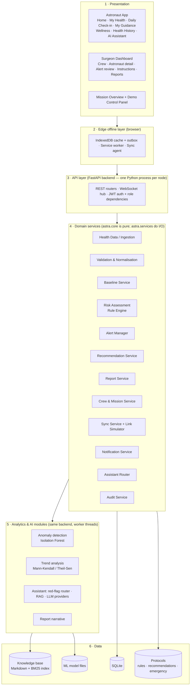
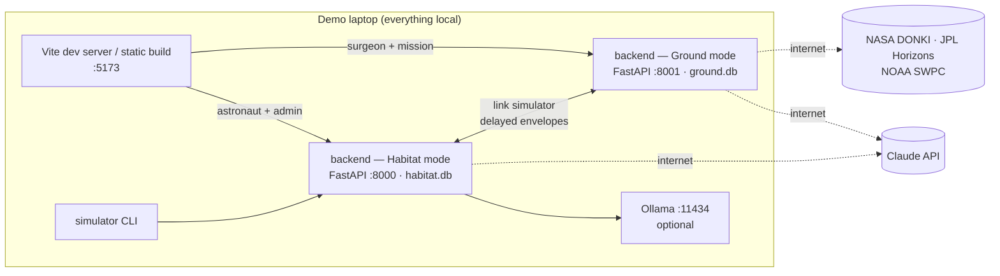
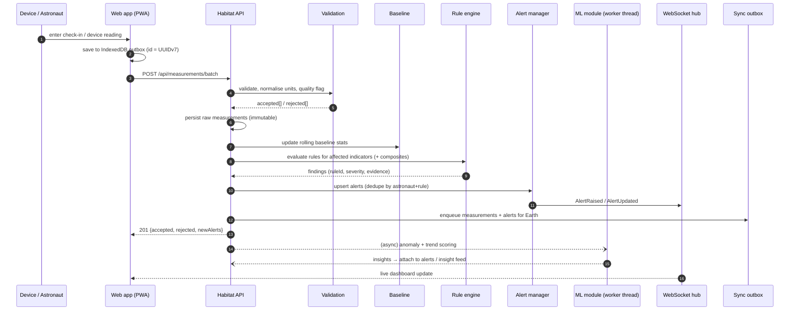
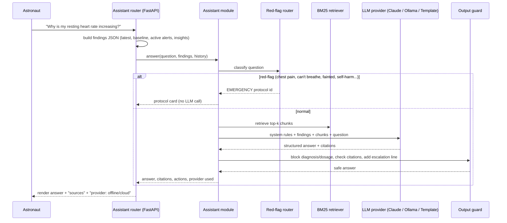
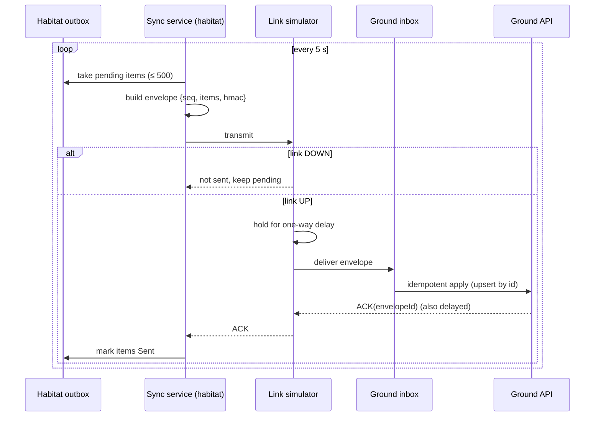
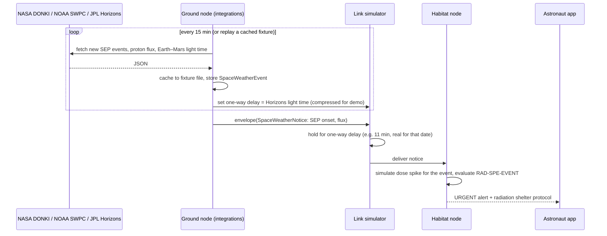

# ASTRA HEALTH — High-Level Design (HLD)

**Version:** 1.0 · **Date:** 2026-11-14
**Read first:** [01-Technical-Design-Document.md](01-Technical-Design-Document.md) (requirements and decisions). Details of every box below are in [03-Low-Level-Design.md](03-Low-Level-Design.md).

Diagrams use Mermaid (renders on GitHub and in VS Code with the Mermaid extension).

---

## 1. System context



**Key idea:** the astronaut never depends on Earth. The Habitat node is a complete system. The Ground node is a *replica plus doctor tools* that is always somewhat behind. It is also the only node that reaches the internet for real space-environment data (TDD ADR-14). Crew physiology is simulated, because real astronaut medical data is not public.

---

## 2. Logical architecture (layers)



---

## 3. Components and responsibilities

| # | Component | Responsibility | Tech | Node(s) |
|---|---|---|---|---|
| C1 | **Astronaut App** | 7 task-based sections (Home, My Health, Daily Check-in, My Guidance, Wellness, Health History, AI Assistant) + emergency procedures; works offline; installable PWA | React/TS/Tailwind | Browser |
| C2 | **Surgeon Dashboard** | Crew list, drill-down, alert review, instructions, reports | Same React app, role-gated routes | Browser → Ground |
| C3 | **Mission Overview** | Crew status colours, mission day, environment, link status | Same React app | Browser → Ground |
| C4 | **Demo Control Panel** | Mission clock, scenario injection, link UP/DOWN, delay slider, reset | Same React app (Admin) | Browser → both |
| C5 | **Browser offline layer** | IndexedDB snapshot cache, outbox of unsent writes, background retry | Dexie, Workbox | Browser |
All backend components are Python modules inside one FastAPI app (`services/backend`, package `astra`).

| # | Component | Responsibility | Module | Node(s) |
|---|---|---|---|---|
| C6 | **API layer** | REST routers, WebSocket hub, JWT, role dependencies, OpenAPI, error handling | `astra.api`, `astra.realtime` | Both |
| C7 | **Ingestion & Validation** | Accept readings (manual/device/bulk), validate, normalise units, flag quality, store immutably | `astra.core.validation` + `astra.services.ingestion` | Habitat |
| C8 | **Baseline Service** | Maintain rolling robust baselines per astronaut × indicator | `astra.core.baselines` (pure) | Habitat |
| C9 | **Rule Engine** | Evaluate versioned JSON rules (single & composite) → findings | `astra.core.rules` (pure) | Habitat (Ground re-uses for display) |
| C10 | **Alert Manager** | Dedupe, create/update alerts, state machine, escalation, acknowledgements | `astra.core.alerts` + `astra.services.alerts` | Both (merge on sync) |
| C11 | **Recommendation Service** | Map findings/routine schedule → actions & tasks | `astra.services.recommendations` + JSON | Habitat |
| C12 | **Report Service** | Build structured reports (daily, weekly, alert-triggered) + narrative | `astra.services.reports` | Both |
| C13 | **Sync Service** | Outbox → envelopes → link simulator → inbox → idempotent apply → ack | `astra.sync` (asyncio background task) | Both |
| C14 | **Link Simulator** | Delay queue, blackout schedule, drop/duplicate injection for testing | `astra.sync.link` | Habitat side |
| C15 | **Notification Service** | Push events to clients over WebSocket; reminder scheduler | `astra.realtime` | Both |
| C16 | **Assistant Router** | Builds context (findings JSON), runs the assistant pipeline, stores chat, audits | `astra.api.assistant` | Both |
| C17 | **ML & Assistant modules** | Anomaly, trend (worker thread); assistant: red-flag → RAG → LLM provider → guard; narrative | `astra.ml`, `astra.assistant` | Habitat (+Ground) |
| C18 | **Simulator** | Generates 120+ days of crew data and live streams from scenario YAML | Python CLI (`simulator/`) | Dev/demo |
| C19 | **Audit Service** | Append-only audit trail | `astra.services.audit` | Both |
| C20 | **External data integrations** | Fetch and cache NASA DONKI SEP events, JPL Horizons light time, NOAA proton flux; forward notices to Habitat | `astra.integrations` | Ground (fixtures replayable anywhere) |

---

## 4. Deployment view



The same code runs twice; environment variables select the role:
```
ASTRA_NODE_ROLE=Habitat  ASTRA_NODE_ID=HAB-ARES-1  ASTRA_PEER_URL=http://localhost:8001  ASTRA_DATABASE_URL=sqlite:///habitat.db
ASTRA_NODE_ROLE=Ground   ASTRA_NODE_ID=GND-MCC     ASTRA_PEER_URL=http://localhost:8000  ASTRA_DATABASE_URL=sqlite:///ground.db
```

---

## 5. Key data flows

### 5.1 Measurement → assessment (the core loop)


### 5.2 Assistant question


### 5.3 Store-and-forward to Earth

Ground → Habitat (instructions, alert reviews, space-weather notices) uses the same mechanism in reverse.

### 5.3a Real space-weather relay (Earth → crew)


### 5.4 Flight surgeon review
Surgeon opens Crew → sees AST-001 YELLOW (data "as of" timestamp shows staleness) → opens alert evidence + charts → marks *In Review* and sends instruction ("Repeat resting HR tomorrow 07:00; reduce EVA prep workload") → envelope to habitat → astronaut receives `InstructionReceived` notification after the link delay → acknowledges → ack flows back.

---

## 6. Module ↔ hazard mapping

| NASA hazard | Indicators (MVP) | Rules / features | Module(s) |
|---|---|---|---|
| Space Radiation | daily dose (mSv) per channel (total / charged / **neutron** — modelled on the CSA's autonomous CANS neutron spectrometer), cumulative dose | Cumulative vs mission limit %, SPE (solar particle event) spike → shelter protocol, cognitive check reminder | Environment panel, Alerts, Body Explorer (brain/bones) |
| Isolation & confinement | mood, stress, fatigue, sleep h/quality | Behavioural composite rule, wellness check-ins, breathing exercise, private psych contact | Wellness Center, Assistant, Alerts |
| Distance from Earth | all indicators, symptoms | Offline-first, protocol guide, store-and-forward reports, link status | Sync, Reports, Emergency Guide |
| Gravity / microgravity | HR, resting HR, BP, activity, exercise sessions, strength, scheduled bone/muscle assessments | RHR vs baseline, exercise adherence rule, assessment-due reminders, orthostatic symptoms | Analytics, Wellness (exercise), Body Explorer (heart/bones/muscles) |
| Hostile/closed environment | temperature, symptoms, hydration, cabin temp/humidity/CO₂ | Fever rule, environment warnings, hydration recommendations | Alerts, Environment panel, Wellness (nutrition) |

The **cross-hazard composite rules** are where the product differentiates, because NASA says the hazards feed off one another. Examples: sleep ↓ + RHR ↑ + fatigue ↑; cabin temp ↑ + hydration ↓ + fatigue ↑; stress ↑ + temperature ↑ (stress can reactivate dormant viruses).

Coverage of NASA's 17 individual risks (Monitored / Partial / Out of scope) is in TDD §13.

---

## 7. Frontend information architecture

Redesigned after Step 11 around the astronaut's tasks (UI redesign, see LLD §15.5). Old paths redirect.

```
/login
/astronaut
  ├── home             Home: how am I now, what changed, something to pay attention to, key measurements, today's tasks
  ├── health           My Health → Body systems (list + diagram + 7-part explanation) · /trends (charts vs your normal)
  ├── checkin          Daily Check-in: 8 guided steps (heart rate, blood pressure, temperature + oxygen, sleep,
  │                    mood + energy, stress, symptoms, review); explicit "not measured"; unusual-value re-measure
  ├── guidance         My Guidance → Recommended actions (by area, search, filters, approved library) · /alerts
  ├── wellness         Wellness: physical activity, sleep, mental wellness (breathing, support), nutrition + hydration
  ├── history          Health History → Timeline (filters, search, by day) · /reports (medical reports)
  ├── assistant        AI Assistant (chat, citations, what it can / cannot do)
  └── emergency        Emergency procedures (bundled, offline; always in the side menu)
/staff
  ├── (index)          Crew overview: communication status, follow-up needed, crew table / cards, space weather
  ├── astronaut/:code  Tabs: summary, body, alerts review, trends, health history, reports, instructions
  ├── emergency        Emergency procedures
  └── sim              Demo control (Admin)
```

Persistent chrome: top bar with **Mission Day / Sol**, **link status pill** (🟢 LINK UP · delay 12 min / 🔴 BLACKOUT · 41 items queued), **SIMULATED DATA** badge, user/role.

---

## 8. Cross-cutting concerns

| Concern | Approach |
|---|---|
| Time | Store UTC; show local mission time + Mission Day / Sol computed from mission start |
| IDs | UUIDv7 everywhere, generated at the edge |
| Errors | Consistent JSON error body `{type, title, status, detail}` (RFC 7807 style) via FastAPI exception handlers; toasts in UI; ML/LLM failures degrade, never block |
| Logging | Python `logging` with structured JSON output and a request-id middleware |
| Config | `pydantic-settings` reading env vars / `.env` (`ASTRA_*`), mission profile JSON |
| Health checks | `/health` reports DB, ML models, LLM provider, link status; shown on Demo Control Panel |
| Observability for demo | "System status" panel: API, AI, LLM provider, link, outbox size |

---

## 9. Scalability and evolution path
- Split modules into services only if needed (Ingestion, Analytics, Assistant are the natural seams).
- Replace SQLite with an embedded encrypted store (SQLCipher) on real hardware.
- Swap BM25 for hybrid BM25 + embeddings; add FHIR mapping (`Observation`, `Condition`, `DiagnosticReport`, `Flag`) for interoperability.
- Replace the simulated device adapters with real ones (Web Bluetooth Heart Rate Service, vendor SDKs) behind the same `IDeviceAdapter` interface.
