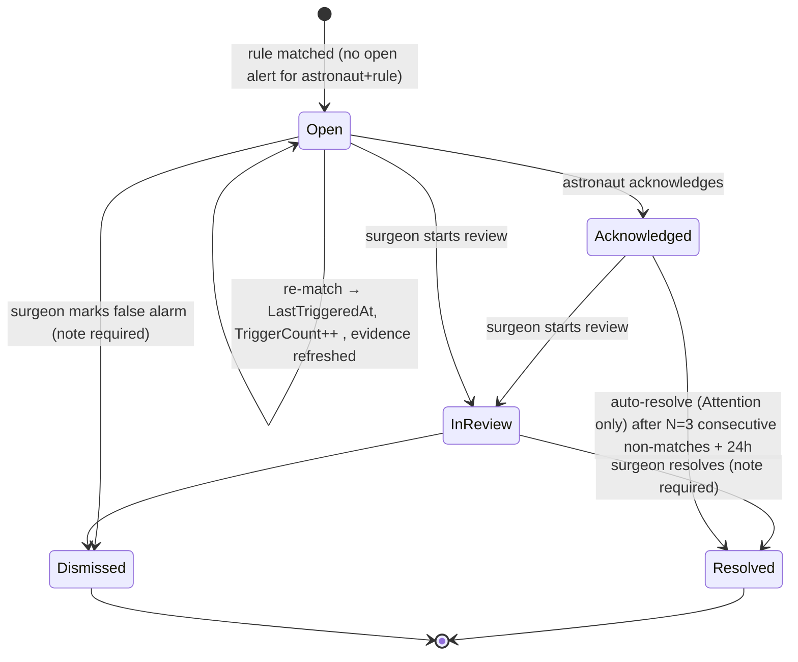

# ASTRA HEALTH — Low-Level Design (LLD)

**Version:** 1.1 (single Python FastAPI backend) · **Date:** 2026-11-14
**Read first:** [02-High-Level-Design.md](02-High-Level-Design.md)

This document is the build reference: folder layout, schemas, algorithms, API contracts, message formats and test cases. All numeric thresholds are **illustrative placeholders** (marked ⚠️) — not clinical values.

---

## 1. Repository layout (monorepo)

```
astra-health/
├── apps/
│   └── web/                          # React + Vite + TS PWA (astronaut, surgeon, mission, admin)
│       ├── src/
│       │   ├── app/                  # router, providers, layout shells per role
│       │   ├── features/
│       │   │   ├── auth/
│       │   │   ├── overview/
│       │   │   ├── checkin/
│       │   │   ├── body-explorer/    # BodyMap2D.tsx, BodyModel3D.tsx, regions.ts
│       │   │   ├── analytics/
│       │   │   ├── assistant/
│       │   │   ├── wellness/
│       │   │   ├── alerts/
│       │   │   ├── reports/
│       │   │   ├── surgeon/
│       │   │   ├── mission/
│       │   │   └── admin-sim/
│       │   ├── components/ui/        # StatusPill, VitalCard, SeverityBadge, BaselineChart...
│       │   ├── lib/                  # api client (generated), realtime.ts (WebSocket), db.ts (Dexie), sync.ts, time.ts
│       │   └── styles/
│       └── public/models/            # body.glb (Phase 2)
├── services/
│   └── backend/                      # ONE Python 3.12 FastAPI app (package `astra`)
│       ├── pyproject.toml
│       ├── alembic/                  # DB migrations
│       ├── astra/
│       │   ├── main.py               # create_app(): routers, middleware, lifespan (starts sync loop, scheduler)
│       │   ├── config.py             # Settings (pydantic-settings, env prefix ASTRA_)
│       │   ├── core/                 # PURE domain — no FastAPI, no DB, no network
│       │   │   ├── enums.py          #   Severity, Hazard, AlertStatus, Quality, NodeRole …
│       │   │   ├── indicators.py     #   catalog loader + unit conversion
│       │   │   ├── validation.py     #   ValidationPipeline (§4)
│       │   │   ├── baselines.py      #   robust median/MAD (§5)
│       │   │   ├── rules/            #   models.py (Pydantic rule DSL), loader.py, engine.py (§6)
│       │   │   ├── alerts.py         #   state machine + merge order (§7)
│       │   │   └── wellness.py       #   wellness index (§9)
│       │   ├── db/                   # models.py (SQLModel tables §3), session.py, repositories.py
│       │   ├── services/             # I/O orchestration: ingestion.py, alerts.py, recommendations.py,
│       │   │                         #   reports.py, audit.py, crew.py
│       │   ├── ml/                   # features.py, isolation.py, trend.py (§10)
│       │   ├── assistant/            # redflag.py, retriever.py, guard.py, prompts.py,
│       │   │                         #   providers/ (claude.py, ollama.py, template.py) (§11)
│       │   ├── sync/                 # outbox.py, envelope.py, sender.py, receiver.py, link.py (§12)
│       │   ├── realtime/             # hub.py — WebSocket connection manager with groups (§14)
│       │   ├── security/             # jwt.py, passwords.py, deps.py (current_user, require_role)
│       │   ├── integrations/         # nasa_donki.py, horizons.py, noaa_swpc.py, fixtures.py (§20)
│       │   └── api/                  # routers: system, auth, measurements, checkins, alerts, …
│       ├── models/                   # trained ML models (git-ignored)
│       └── tests/
│           ├── core/                 # unit tests for astra.core
│           ├── api/                  # TestClient tests per router
│           └── scenarios/            # golden scenario tests
├── simulator/
│   ├── simulate.py                   # Typer CLI: seed / stream / inject
│   ├── fixtures/                     # cached real API responses (donki-sep-2024-05.json, horizons-*.json, …)
│   └── scenarios/                    # crew.yaml, fatigue_day114.yaml, fever.yaml, spe_radiation.yaml, sensor_glitch.yaml
├── protocols/
│   ├── indicators.json               # indicator catalog (units, plausible ranges, floors)
│   ├── rules/                        # *.json rule files
│   ├── recommendations.json
│   ├── emergency/                    # EMG-*.md step-by-step procedures
│   └── mission-profiles/             # mars-surface.json, transit.json, iss.json
├── knowledge/                        # curated KB markdown with front-matter source URLs
├── docs/
├── start-demo.ps1                    # launches habitat + ground + web
└── README.md
```

**Rule:** `astra.core` must not import FastAPI, SQLModel/SQLAlchemy or httpx. It is plain Python (with Pydantic models), so it is trivially unit-testable and could be reused anywhere. Enforce with a test that scans its imports.

---

## 2. Indicator catalog (`protocols/indicators.json`)

| Code | Name | Canonical unit | Accepted input units | Plausible range (reject outside) | Spread floor σ_min ⚠️ | Hazard / system | Collection |
|---|---|---|---|---|---|---|---|
| `heart_rate` | Heart rate | bpm | bpm | 25–250 | 3 | gravity / heart | wearable, continuous |
| `resting_hr` | Resting heart rate | bpm | bpm | 30–150 | 2 | gravity / heart | derived (wearable, morning) |
| `bp_sys` | Systolic BP | mmHg | mmHg, kPa (×7.50062) | 60–260 | 4 | gravity / heart | BP monitor, daily |
| `bp_dia` | Diastolic BP | mmHg | mmHg, kPa | 30–160 | 3 | gravity / heart | BP monitor, daily |
| `body_temp` | Body temperature | °C | °C, °F ((F−32)×5/9) | 30–43 | 0.15 | environment / immune | thermometer, daily |
| `glucose` | Blood glucose | mg/dL | mg/dL, mmol/L (×18.016) | 20–600 | 5 | metabolic / digestive | meter, as required |
| `spo2` | Oxygen saturation | % | % | 50–100 | 0.7 | lungs | oximeter, as required |
| `sleep_hours` | Sleep duration | h | h, min (÷60) | 0–16 | 0.4 | isolation / brain | wearable/manual, daily |
| `sleep_quality` | Sleep quality | 1–10 | score | 1–10 | 1 | isolation / brain | questionnaire |
| `mood` | Mood | 1–10 | score | 1–10 | 1 | isolation / brain | questionnaire |
| `stress` | Stress | 1–10 | score | 1–10 | 1 | isolation / brain | questionnaire |
| `fatigue` | Fatigue | 1–10 | score | 1–10 | 1 | isolation / brain | questionnaire |
| `activity_min` | Physical activity | min | min | 0–600 | 10 | gravity / muscles | wearable/log |
| `exercise_sessions` | Resistance sessions (weekly) | count | count | 0–21 | 1 | gravity / bones+muscles | exercise log |
| `strength_index` | Muscle strength (vs pre-flight) | % | % | 0–200 | 3 | gravity / muscles | equipment, weekly |
| `body_weight` | Body weight | kg | kg, lb (×0.453592) | 30–200 | 0.5 | nutrition | scale, weekly |
| `hydration_ml` | Fluid intake | mL/day | mL, L (×1000) | 0–8000 | 200 | environment / digestive | manual log |
| `radiation_dose` | Daily radiation dose (channels: `total`, `charged`, `neutron`) | mSv/day | mSv, µSv (÷1000) | 0–500 | n/a (absolute rules) | radiation | dosimeter / autonomous neutron spectrometer (CANS-like, simulated) |
| `light_exposure` | Daytime light exposure (P2) | lux·h | lux·h | 0–200000 | n/a | isolation / sleep | actigraphy wrist device (modelled on NASA ARCHeR) |
| `cabin_temp` | Cabin temperature | °C | °C, °F | 0–50 | n/a | environment | habitat sensor |
| `cabin_humidity` | Relative humidity | % | % | 0–100 | n/a | environment | habitat sensor |
| `cabin_co2` | CO₂ | mmHg | mmHg, ppm (÷1316 approx) | 0–20 | n/a | environment | habitat sensor |

**JSON format** (each entry in `protocols/indicators.json`; 22 indicators as built):
```json
{ "code": "glucose", "name": "Blood glucose", "unit": "mg/dL",
  "units": { "mg/dL": { "factor": 1 }, "mmol/L": { "factor": 18.016 } },
  "plausible": { "min": 20, "max": 600 }, "sigmaFloor": 5, "decimals": 1, "worseWhen": "both",
  "hazard": "Environment", "bodySystem": "digestive", "collection": "Glucose meter (as required)" }
```
- **Conversion:** `canonical = (value + offset) × factor`, rounded half-up to `decimals`. For °F → °C, `offset` is −32 and `factor` is 5/9.
- **Unit lookup** ignores case.
- **`sigmaFloor: null`** means the indicator gets no personal baseline, so only absolute rules and `ratio_gte` apply (radiation, cabin sensors).
- **`worseWhen`** (`high` / `low` / `both`) tells the wellness index which direction counts as bad.

Scheduled assessments (bone density, balance, cognitive test, immune panel) are stored as `Assessment` records with a result and due date — not inferred.

---

## 3. Database schema (SQLModel tables, SQLite; Alembic migrations)

Conventions: PK `Id` = UUIDv7 stored as text (`uuid6.uuid7()` or Python 3.14's `uuid.uuid7()`) unless noted; all timestamps timezone-aware UTC `datetime`; column names below are logical (use snake_case in Python); `OriginNodeId` + `CreatedAt` + `UpdatedAt` + `Version` (int) on every syncable entity.

### 3.1 Identity & crew
```
Users            (Id, Username UNIQUE, PasswordHash, Role ENUM[Astronaut,FlightSurgeon,MissionControl,Admin],
                  AstronautId NULL FK, DisplayName, IsActive)
Missions         (Id, Code UNIQUE 'ARES-1', Name, ProfileCode 'mars-surface', StartDate,
                  GravityG 0.38, RadiationLimitMsv, CommsDelayMinMin, CommsDelayMaxMin)
Astronauts       (Id, Code UNIQUE 'AST-001', DisplayName, MissionId FK, DateOfBirth, Sex, HeightCm,
                  Role 'Commander', PreflightNotes)
HealthBaselines  (Id, AstronautId FK, IndicatorCode, Method 'robust_median_mad',
                  Median, Mad, Sigma, SampleCount, WindowStart, WindowEnd, Source ENUM[Preflight,Rolling,Manual],
                  ComputedAt)   UNIQUE(AstronautId, IndicatorCode, Source)
PersonalLimits   (Id, AstronautId FK, IndicatorCode, LowAttention, HighAttention, LowUrgent, HighUrgent,
                  SetBy UserId, Reason, EffectiveFrom)        -- surgeon overrides of protocol defaults
```

### 3.2 Health data (raw evidence — append-only)
```
HealthMeasurements (Id, AstronautId FK, IndicatorCode, Value REAL, Unit, OriginalValue, OriginalUnit,
                    MeasuredAt, ReceivedAt, Source ENUM[Manual,Wearable,Device,Derived,Simulated],
                    DeviceId NULL, PanelId NULL,      -- groups e.g. bp_sys+bp_dia of one reading
                    Quality ENUM[Valid,Questionable,Rejected], QualityReason NULL,
                    SupersedesId NULL, IsSimulated BOOL, OriginNodeId)
   INDEX (AstronautId, IndicatorCode, MeasuredAt DESC)
   UNIQUE (AstronautId, IndicatorCode, MeasuredAt, DeviceId)   -- duplicate guard for devices

WellnessCheckins   (Id, AstronautId, Date, SleepHours, SleepQuality, Mood, Stress, Fatigue,
                    PrivateNoteEncrypted NULL, CompletedInSeconds, CreatedAt)
                    -- on save, also emits HealthMeasurements rows for each score (single analytics path)
Symptoms           (Id, AstronautId, SymptomCode 'dizziness', FreeText NULL, Severity 1-10, OnsetAt,
                    ResolvedAt NULL, BodyRegion NULL, RedFlag BOOL, Source ENUM[Form,Voice,Assistant])
ExerciseRecords    (Id, AstronautId, Type ENUM[Resistance,Aerobic,Treadmill,Cycle], DurationMin, LoadKg NULL,
                    PerceivedExertion 1-10, PerformedAt)
RadiationExposures (Id, AstronautId NULL, DoseMsv, Channel ENUM[Total,Charged,Neutron], PeriodStart, PeriodEnd,
                    EventType ENUM[Background,SPE,EVA], InstrumentType ENUM[PersonalDosimeter,NeutronSpectrometer,AreaMonitor],
                    DosimeterId)   -- AstronautId NULL = habitat-wide; neutrons ≈ 30 % of ISS radiation (CSA)
EnvironmentReadings(Id, MissionId, Module 'HAB-A', CabinTempC, HumidityPct, Co2MmHg, MeasuredAt)
Assessments        (Id, AstronautId, Type ENUM[BoneDensity,Balance,Cognitive,ImmunePanel,Ultrasound,Strength,VisionCheck],
                    DueAt, CompletedAt NULL, ResultJson NULL, ResultSummary NULL, ReviewedBy NULL)
Devices            (Id, AstronautId NULL, Type, Model, SerialNo, LastSyncAt, BatteryPct, IsSimulated)
```

### 3.3 Intelligence output (derived — re-computable)
```
HealthAlerts      (Id, AstronautId, RuleId, RuleVersion, Category ENUM[Cardiovascular,Behavioral,Metabolic,
                   Respiratory,Thermal,Musculoskeletal,Radiation,Environment,Symptom],
                   Hazard ENUM[Radiation,Isolation,Distance,Gravity,Environment],
                   Severity ENUM[Attention,Urgent], Status ENUM[Open,Acknowledged,InReview,Resolved,Dismissed],
                   Title, Reason, EvidenceJson, FirstTriggeredAt, LastTriggeredAt, TriggerCount,
                   AcknowledgedAt NULL, AcknowledgedBy NULL, ReviewedBy NULL, ResolvedAt NULL,
                   ResolutionNote NULL, EscalationRequired BOOL, Version, OriginNodeId)
   UNIQUE filtered index: (AstronautId, RuleId) WHERE Status IN (Open,Acknowledged,InReview)
Insights          (Id, AstronautId, Kind ENUM[Anomaly,Trend], IndicatorCodes, Score, Direction NULL,
                   Explanation, ContributorsJson, WindowStart, WindowEnd, ModelVersion, CreatedAt,
                   LinkedAlertId NULL)
Recommendations   (Id, AstronautId, AlertId NULL, Code 'REC-SLEEP-ROUTINE', Title, Body, Category,
                   Priority, DueAt NULL, Status ENUM[Pending,Done,Skipped], CompletedAt NULL, Source ENUM[Rule,Routine,Surgeon])
MedicalInstructions(Id, AstronautId, AlertId NULL, FromUserId, Text, CreatedAt, DeliveredAt NULL,
                   AcknowledgedAt NULL, OriginNodeId)
MedicalReports    (Id, AstronautId, Type ENUM[Daily,Weekly,AlertTriggered,OnDemand], PeriodStart, PeriodEnd,
                   SummaryJson, NarrativeText NULL, NarrativeProvider NULL, GeneratedAt,
                   TransmissionStatus ENUM[Queued,Sent,Delivered])
MedicalActions    (Id, AlertId, ActionTaken, PerformedBy, PerformedAt)
WellnessScores    (AstronautId, Date, Overall, CardioScore, SleepScore, BehavioralScore, ActivityScore,
                   MetabolicScore, EnvironmentScore, CapReason NULL)   PK(AstronautId, Date)
```

### 3.4 Assistant, sync, audit
```
ChatMessages   (Id, SessionId, AstronautId, Role ENUM[User,Assistant], Text, CitationsJson, Provider,
                SafetyFlags, CreatedAt)
SyncOutbox     (Seq INTEGER PK AUTOINCREMENT, EntityType, EntityId, Operation ENUM[Upsert], PayloadJson,
                CreatedAt, Status ENUM[Pending,InFlight,Sent,Acked], EnvelopeId NULL, Attempts)
SyncInbox      (EnvelopeId PK, FromNodeId, Seq, ReceivedAt, AppliedAt, ItemCount)   -- idempotency
SyncState      (PeerNodeId PK, LastSentSeq, LastAckedSeq, LastReceivedSeq, LinkStatus, UpdatedAt)
AuditLog       (Id BIGINT PK, UserId, Action, EntityType, EntityId, AtUtc, Details, NodeId)
```

### 3.5 Example records
```json
// HealthMeasurement
{ "id": "0193a6f2-7c1e-7b10-9a11-2f6f3c1b0001", "astronautId": "AST-001",
  "indicatorCode": "resting_hr", "value": 89, "unit": "bpm",
  "measuredAt": "2026-11-14T07:02:00Z", "source": "Wearable", "deviceId": "WR-01",
  "quality": "Valid", "isSimulated": true }

// HealthAlert
{ "id": "0193a6f2-...", "astronautId": "AST-001", "ruleId": "BEH-FATIGUE-COMPOSITE",
  "ruleVersion": "1.0.0", "category": "Behavioral", "hazard": "Isolation",
  "severity": "Attention", "status": "Open",
  "title": "Fatigue & recovery pattern needs review",
  "reason": "Sleep has averaged 4.9 h over 4 days (your normal 7.1 h), resting HR is 89 bpm (your normal 64 ± 3), and fatigue was rated 8/10.",
  "evidence": { "sleep_hours": { "agg": "mean", "window": "4d", "value": 4.9, "baseline": 7.1, "z": -3.1 },
                "resting_hr": { "agg": "latest", "value": 89, "baseline": 64, "z": 5.6 },
                "fatigue":    { "agg": "latest", "value": 8 } },
  "escalationRequired": false }
```

---

## 4. Validation & normalisation (`astra/core/validation.py`)

Order of checks per incoming reading:

1. **Schema**: indicator code exists; value numeric; `measuredAt` present.
2. **Unit normalisation**: convert to canonical unit using catalog factor/formula; keep `OriginalValue/OriginalUnit`. Unknown unit → `Rejected("unknown_unit")`.
3. **Timestamp**: `measuredAt` > now + 5 min → `Rejected("future_timestamp")`; older than 30 days → `Questionable("late_arrival")` (allowed for backfill/simulator with `X-Backfill: true`).
4. **Plausibility**: outside catalog range → `Rejected("implausible")`.
5. **Duplicate**: same (astronaut, indicator, measuredAt, device) → idempotent no-op returning existing id.
6. **Device quality**: device-reported `signalQuality < 0.6` or `motionArtifact = true` → `Questionable("low_signal")`.
7. **Jump check**: |value − previous valid| / σ > 6 within 10 min (HR, SpO₂, temp) → `Questionable("sudden_jump")`, create **Recheck** task.
8. **Cross-field**: `bp_sys` ≤ `bp_dia` in same panel → both `Rejected("bp_inconsistent")`.

Result object: `ValidationResult { Quality, Reason, NormalisedValue, Unit }`.

---

## 5. Baseline service (`astra/core/baselines.py`)

### 5.1 Algorithm — robust rolling baseline
```
Inputs: valid readings of (astronaut, indicator); config windowDays (default 28), minSamples (default 7)
1. For high-frequency indicators (heart_rate), aggregate to one value per day first (daily median).
2. Window = last windowDays EXCLUDING:
     - readings with Quality != Valid
     - days where an Open/InReview alert existed for this indicator (don't learn the abnormal as normal)
     - the most recent 3 days (so a developing trend doesn't drag the baseline with it)
3. If count < minSamples → fall back to Preflight baseline; if none → catalog population default (flag "provisional").
4. median = Median(xs)
   mad    = Median(|x - median|)
   sigma  = max(1.4826 * mad, sigmaFloor[indicator])
5. Store HealthBaseline(Source=Rolling). Recompute nightly (mission midnight) and on demand.
```
Deviation for any value `x`:  `z = (x − median) / sigma`.

### 5.2 Pre-flight baseline
Seeded by the simulator as 30 days of "pre-flight" readings (Source=Preflight). Shown in analytics as a dashed reference line ("pre-flight normal") — this is how the *Digital Health Twin* compares "now vs start of mission".

### 5.3 Interface
```python
@dataclass(frozen=True)
class Baseline:
    indicator: str
    median: float
    sigma: float
    samples: int
    provisional: bool

def compute_baseline(indicator: str, history: Sequence[DailyValue],
                     opts: BaselineOptions, sigma_floor: float) -> Baseline: ...
```

---

## 6. Rule engine (`astra/core/rules/`)

### 6.1 Rule file format (JSON DSL)
```json
{
  "id": "BEH-FATIGUE-COMPOSITE",
  "version": "1.0.0",
  "title": "Fatigue & recovery pattern needs review",
  "category": "Behavioral",
  "hazard": "Isolation",
  "severity": "Attention",
  "when": {
    "all": [
      { "indicator": "sleep_hours", "agg": "mean",   "window": "4d", "op": "z_lte", "value": -1.5 },
      { "indicator": "resting_hr",  "agg": "latest", "window": "1d", "op": "z_gte", "value":  1.5 },
      { "any": [
          { "indicator": "fatigue", "agg": "latest", "window": "1d", "op": "gte", "value": 7 },
          { "indicator": "mood",    "agg": "mean",   "window": "3d", "op": "lte", "value": 4 }
      ]}
    ]
  },
  "persistence": { "minTriggers": 1 },
  "reasonTemplate": "Sleep has averaged {sleep_hours.value:.1f} h over 4 days (your normal {sleep_hours.baseline:.1f} h), resting heart rate is {resting_hr.value:.0f} bpm (your normal {resting_hr.baseline:.0f}), and fatigue was rated {fatigue.value:.0f}/10.",
  "recommendations": ["REC-RECHECK-RHR", "REC-FATIGUE-ASSESS", "REC-SLEEP-ROUTINE", "REC-WORKLOAD-REVIEW"],
  "escalation": { "whenTriggerCountGte": 3 },
  "disclaimer": "Illustrative rule for prototype; not a clinical threshold."
}
```
The six starter rules are in `protocols/rules/` (one file per rule; the file name must equal the rule id).

**Leaf fields:** `indicator`, `agg`, `window`, `op`, `value`, optional `value2` (range ops), optional `aggArg` (for `count_z_gte`), optional `as` (evidence name; needed when the same indicator appears twice in one rule).
**Aggregations:** `latest`, `mean`, `min`, `max`, `sum`, `count`, `slope` (per day, Theil–Sen), `count_z_gte` (how many readings in the window have z ≥ `aggArg`).
**Windows:** `Nd` (days), `Nr` (last N readings), `mission` (since mission start).
**Operators:**
- On the value: `gt`, `gte`, `lt`, `lte`, `eq`, `between` (value ≤ x ≤ value2), `outside` (x ≤ value or x ≥ value2).
- `z_gt`, `z_gte`, `z_lt`, `z_lte` on the robust z vs the personal baseline (only for indicators with a `sigmaFloor`).
- `ratio_gte` (x ÷ baseline median), `pct_of_limit_gte` (radiation).
- `insight` (an ML insight exists in the window): **Attention rules only**.

**Combinators:** `all`, `any`, `not`, nested.
**Rule-level fields:** `protocol` (id of an emergency procedure in `protocols/emergency/`, required in practice for Urgent rules), `persistence.minTriggers`, `escalation.whenTriggerCountGte`.
**Reason templates** use Python format syntax, `{<evidenceKey>.<attr>:<spec>}`. Here `attr` ∈ {`value`, `baseline`, `sigma`, `z`, `ratio`}, e.g. `{resting_hr.z:+.1f}`.

**Load-time checks** (`astra/core/rules/loader.py`, tests T-R-07): every check reports the file name, and all problems are listed together.
- Unknown indicator, op, recommendation or protocol.
- A z-op on an indicator with no baseline.
- An Urgent rule using `insight`.
- A duplicate evidence key or rule id, or a file name that doesn't match the rule id.
- A template field that doesn't exist, or an invalid format spec.
- Any unknown JSON field (catches typos such as `sigmaFlor`).

### 6.2 Starter rule set (⚠️ illustrative)
| Rule id | Severity | Condition (summary) |
|---|---|---|
| `CV-RHR-BASELINE` | Attention | resting_hr latest z ≥ 2 AND `count_where_z_gte:2` over last 3r ≥ 2 (persistence) |
| `CV-HR-CRITICAL` | **Urgent** | heart_rate latest (Valid) > 150 at rest or < 35 |
| `CV-BP-HIGH` | Attention | bp_sys mean 3r ≥ 140 OR bp_dia mean 3r ≥ 90 |
| `CV-BP-CRITICAL` | **Urgent** | bp_sys ≥ 180 OR bp_dia ≥ 120 (repeat-confirmed) OR bp_sys < 85 with dizziness symptom |
| `TH-FEVER` | Attention | body_temp ≥ 38.0 |
| `TH-FEVER-HIGH` | **Urgent** | body_temp ≥ 39.5 OR ≤ 35.0 |
| `RS-SPO2-LOW` | Attention | spo2 latest ≤ 94 (Valid, repeat) |
| `RS-SPO2-CRITICAL` | **Urgent** | spo2 ≤ 90 on repeat reading |
| `MET-GLUCOSE-LOW` | **Urgent** | glucose < 54 |
| `MET-GLUCOSE-OUT` | Attention | glucose < 70 OR > 180 |
| `BEH-FATIGUE-COMPOSITE` | Attention | as §6.1 |
| `BEH-WELLBEING-DECLINE` | Attention | mood mean 5d ≤ 4 AND stress mean 5d ≥ 7 |
| `SLP-DEFICIT` | Attention | sleep_hours mean 4d z ≤ −2 OR mean 4d < 5.5 |
| `MSK-EXERCISE-ADHERENCE` | Attention | exercise_sessions sum 7d < mission target (e.g. 5) |
| `MSK-STRENGTH-DECLINE` | Attention | strength_index slope 28d < −0.3 %/day OR latest z ≤ −2 |
| `RAD-SPE-EVENT` | **Urgent** | radiation_dose latest ≥ 10× habitat daily median (SPE) → shelter protocol |
| `RAD-CUMULATIVE` | Attention | cumulative mission dose ≥ 50 % / 75 % of mission limit |
| `ENV-HEAT-HYDRATION` | Attention | cabin_temp mean 1d ≥ 27 AND hydration_ml latest < 2000 AND fatigue ≥ 6 |
| `ENV-CO2-HIGH` | Attention | cabin_co2 mean 1d ≥ 4 mmHg |
| `IMM-STRESS-FEVER` | Attention | stress mean 5d ≥ 7 AND body_temp latest ≥ 37.5 (NASA: stress can reactivate dormant viruses) |
| `SANS-VISION-SYMPTOM` | Attention | symptom `vision_change` reported OR VisionCheck assessment result worse than pre-flight → book surgeon review (SANS) |
| `SYM-REDFLAG` | **Urgent** | symptom with RedFlag = true (chest pain, severe breathlessness, syncope, confusion, severe bleeding, self-harm thoughts) |
| `ML-ANOMALY-CORROBORATED` | Attention | `insight` Anomaly score ≥ 0.65 in 2d AND any behavioural or cardio indicator z ≥ 1.5 |

### 6.3 Evaluation algorithm
```
EvaluateForAstronaut(astronautId, changedIndicators):
  rules = RuleRepository.RulesReferencing(changedIndicators) ∪ compositeRulesTouching(changedIndicators)
  ctx   = EvaluationContext(series loader with per-window caching, baselines, insights, symptoms)
  for rule in rules:
      result = Eval(rule.when, ctx)       // returns (bool matched, Dictionary<string, Evidence> evidence)
      if result.matched: yield Finding(rule, evidence, Render(rule.reasonTemplate, evidence))
      else:              yield NonMatch(rule)            // used for auto-clear tracking

Eval(node):
  all → every child true (collect evidence from all)
  any → at least one child true (evaluate EVERY child and record all evidence, no short-circuit,
        so templates and the UI can show every value)
  not → negate
  leaf→ series = ctx.Series(indicator, window, qualityFilter = Valid)
        if series empty → false, evidence.missing = true
        v = Aggregate(series, agg)
        if op starts with z_: z = (v - baseline.median)/baseline.sigma ; compare z
        else compare v
        evidence[indicator] = {agg, window, value: v, baseline: median, sigma, z}
```
Pure function: `evaluate(rules: Sequence[Rule], ctx: EvaluationContext) -> list[Finding]`; no I/O inside. `EvaluationContext` is a `Protocol`, so tests pass an in-memory implementation and the app passes a DB-backed one.

### 6.4 Python shapes (Pydantic v2)
```python
class LeafNode(BaseModel):
    indicator: str
    agg: Agg                      # Literal["latest","mean","min","max","count","slope","sum", ...]
    window: str = "1d"            # "4d", "3r", "mission"
    op: Op                        # Literal["gt","gte","lt","lte","eq","between","outside","z_gte","ratio_gte", ...]
    value: float
    value2: float | None = None   # between / outside
    agg_arg: float | None = None  # count_z_gte threshold
    as_: str | None = Field(default=None, alias="as")   # evidence key; defaults to indicator

class AllNode(BaseModel):
    all: list["Condition"]

class AnyNode(BaseModel):
    any: list["Condition"]

class NotNode(BaseModel):
    not_: "Condition" = Field(alias="not")

Condition = LeafNode | AllNode | AnyNode | NotNode   # Pydantic picks the variant by its keys

class Rule(BaseModel):
    id: str
    version: str                  # semver
    title: str
    category: AlertCategory
    hazard: Hazard
    severity: Severity
    when: Condition
    persistence: Persistence = Persistence()
    reason_template: str = Field(alias="reasonTemplate")
    recommendations: list[str] = []
    escalation: Escalation = Escalation()

@dataclass(frozen=True)
class Evidence:
    indicator: str; agg: str; window: str
    value: float | None; baseline: float | None; sigma: float | None; z: float | None
    ratio: float | None = None     # value / baseline median (ratio_gte)
    missing: bool = False

@dataclass(frozen=True)
class Finding:
    rule: Rule
    evidence: dict[str, Evidence]
    reason: str
```
`load_rules(path)` parses every `rules/*.json` with `Rule.model_validate_json`, then validates on startup: unknown indicator, unknown recommendation code or bad operator → raise with the file name, so the app refuses to start (test T-R-07).

---

## 7. Alert manager & state machine


Rules:
- **Dedupe key** = (AstronautId, RuleId) among non-terminal states.
- **Severity upgrade**: if a related Urgent rule (same category) matches while an Attention alert is open → create the Urgent alert and link (`RelatedAlertId`); Attention stays.
- **Urgent alerts never auto-resolve.**
- **Escalation**: `EscalationRequired = true` when Severity = Urgent, or `TriggerCount ≥ rule.escalation.whenTriggerCountGte`, or astronaut presses "Contact surgeon". Escalation → generate `AlertTriggered` report + enqueue with priority.
- **Every transition** writes `AuditLog` and emits `AlertUpdated` over the WebSocket hub, and enqueues an outbox item.
- **Merge across nodes** (sync): state order `Open(0) < Acknowledged(1) < InReview(2) < Resolved/Dismissed(3)`; on conflict take the higher state; tie → later `UpdatedAt`; field-level union for AcknowledgedAt/ReviewedBy.

---

## 8. Recommendation service

`protocols/recommendations.json`:
```json
{ "code": "REC-SLEEP-ROUTINE", "title": "Follow your prescribed sleep routine tonight",
  "body": "Dim lighting 60 min before sleep period, avoid screens, keep sleep station at assigned temperature, use the 10-min wind-down audio.",
  "category": "Sleep", "priority": 2, "dueInHours": 14, "hazards": ["Isolation"],
  "source": "Illustrative — replace with mission behavioural-health protocol" }
```
- On alert creation → materialise its `recommendations[]` into `Recommendations` rows (skip if same code Pending for that astronaut).
- **Routine engine** (daily at mission 06:00): exercise session tasks per mission profile, hydration target, check-in reminder, assessments due (from `Assessments.DueAt`).
- Wellness "missions" (gamification) = routine tasks with streak counters; **never** tied to health values themselves.

---

## 9. Wellness index

```
domainScore(d) = 100 − Σ penalty(indicator in d)
   penalty = clamp( (|z| − 1) * 15, 0, 40 )  for z-based indicators (only in the "bad" direction)
           + 25 if an Attention alert of that category is open
sleep penalty also uses absolute: +20 if sleep_hours mean 3d < 6
overall_raw = 0.25·Cardio + 0.20·Sleep + 0.20·Behavioral + 0.15·Activity + 0.10·Metabolic + 0.10·Environment
overall     = min(overall_raw, 40 if any Urgent open, 75 if any Attention open, 100)
```
Status shown on Overview: GREEN ≥ 80 and no alerts · YELLOW otherwise · RED if any Urgent. Missing data reduces confidence (shown as "based on 7/10 indicators today"), not the score.

---

## 10. ML module — anomaly & trend (`astra/ml/`)

### 10.1 Daily feature vector per astronaut
`[resting_hr, hr_mean, bp_sys, bp_dia, body_temp, spo2_min, sleep_hours, sleep_quality, mood, stress, fatigue, activity_min]`
Missing values → forward-fill ≤ 2 days else column median; standardise with the astronaut's baseline (median/σ) → features are robust z-scores.

### 10.2 Isolation Forest
- Train per astronaut on pre-flight + first ≥ 21 mission days excluding alert days. `IsolationForest(n_estimators=200, contamination="auto", random_state=42)`.
- Score: `anomaly = clip(−model.score_samples(x) normalised to 0–1 over training distribution)`.
- **Contributors**: rank features by |z| for that day (simple, explainable); return top 3.
- Persist `models/{astronautId}.joblib` with `model_version = sha of training window`.
- Retrain nightly (scheduler task) or via `POST /api/admin/ml/train`.

### 10.3 Trend detection
- Mann–Kendall test (`pymannkendall.original_test`) on last 14 daily values per indicator; Theil–Sen slope.
- Insight if `p < 0.05` AND |slope × 14| ≥ 1 σ (moves at least one personal σ over 2 weeks) in the unhealthy direction.

### 10.4 Module functions (called in-process, not over HTTP)
```python
# astra/ml/isolation.py
def train(astronaut_id: str, rows: pd.DataFrame) -> ModelInfo                 # → model_version, n_train
def score(astronaut_id: str, rows: pd.DataFrame) -> list[AnomalyScore]       # date, score, contributors[(feature, z)]
# astra/ml/trend.py
def trend(series: pd.Series, sigma: float) -> TrendResult                    # increasing|decreasing|none, p, slope_per_day
```
**How it is called:** after a check-in or a day's data is complete, `services/ingestion.py` schedules `run_insights(astronaut_id)` with FastAPI `BackgroundTasks`; it runs the CPU work via `anyio.to_thread.run_sync` with a 10 s limit. Any exception is logged and the insight is skipped; the request has already returned and the rule alerts are already stored (test T-ML-02).

---

## 11. AI assistant (`astra/assistant/`)

### 11.1 Contract of `assistant.answer(request) -> AssistantResponse`
The `/api/assistant/chat` router builds this request from the database (findings) and the user's question, then calls the module in-process.
```json
// AssistantRequest
{ "astronautCode": "AST-001",
  "question": "Why is my resting heart rate increasing?",
  "history": [{"role":"user","text":"..."},{"role":"assistant","text":"..."}],
  "findings": {
     "missionDay": 120, "gravity": "Mars 0.38 g",
     "latest": { "resting_hr": {"value": 89, "baseline": 64, "sigma": 3, "z": 8.3, "at": "..."} , "...": {} },
     "activeAlerts": [{ "ruleId": "BEH-FATIGUE-COMPOSITE", "severity": "Attention", "reason": "...", "escalationRequired": false }],
     "insights": [{ "kind": "Trend", "indicator": "sleep_hours", "direction": "decreasing", "p": 0.01 }]
  },
  "preferredProvider": "auto" }

// response
{ "answer": "…plain-language explanation…",
  "citations": [{"chunkId": "kb-cardio-microgravity#3", "title": "Cardiovascular deconditioning", "source": "https://..."}],
  "suggestedActions": ["Recheck resting HR tomorrow at wake-up", "Follow sleep routine"],
  "safetyFlags": [], "mode": "llm|template|emergency", "provider": "claude|ollama|template",
  "emergencyProtocolId": null }
```

### 11.2 Pipeline
1. **Red-flag router** (deterministic): normalised text matched against `redflags.yaml` (phrases + simple patterns, e.g. `chest (pain|pressure|tight)`, `can'?t breathe`, `passed out|fainted|syncope`, `confus(ed|ion)`, `severe bleeding`, `vision loss`, `suicid|self[- ]harm|end my life`). Match → return `mode=emergency` with protocol (`EMG-CHEST-PAIN`, `EMG-SYNCOPE`, `EMG-BEHAVIORAL-CRISIS` …) and the router creates a `Symptom(RedFlag=true)` → Urgent alert. **No LLM call.**
2. **Retriever**: BM25 over KB chunks (≈ 300–500 tokens, split on headings); query = question + names of active alert categories; top-k = 5.
3. **Provider selection**: `auto` → Claude if `ANTHROPIC_API_KEY` set and link-mode permits → else Ollama if reachable → else Template.
4. **Prompt** (system, stable → cacheable):
   - Role: onboard health *information* assistant for astronauts; audience non-medical; concise.
   - Hard rules: do not diagnose; do not recommend medication, doses or treatment changes; do not change or contradict severity in `activeAlerts`; base personal statements only on `findings`; base general statements only on provided knowledge chunks and cite them by chunkId; if information is missing say so; if any alert has `escalationRequired` or the user describes worsening symptoms, tell them to contact the flight surgeon/CMO per protocol; all data is simulated.
   - Output: JSON matching the response schema (structured outputs via `output_config.format`).
   - User turn: findings JSON + chunks (with ids) + question.
5. **Claude call settings** (Python `anthropic` SDK): model from env `ASTRA_LLM_MODEL` (default `claude-opus-5-5`), adaptive thinking with `effort: "low"` for responsiveness, `max_tokens ≈ 2000`, refusal fallback enabled; on `stop_reason == "refusal"` or any API error → Template provider. Exact SDK calls must follow the official SDK docs at implementation time.
6. **Guard** (post-filter): reject/rewrite answers containing dosage patterns (`\d+\s?(mg|mcg|ml|units)`), "you have <disease>", "diagnos"; drop citations to unknown chunk ids; append escalation line if required; if answer fails twice → Template.
7. **Template provider**: deterministic text built from findings (e.g. "Your resting heart rate is 89 bpm; your personal normal is 64 ± 3 bpm. Common contributors include poor sleep, dehydration, stress and exercise recovery …") + first sentence of top-2 chunks + standard actions from active alerts' recommendations.

### 11.3 Knowledge base format (`knowledge/*.md`)
```markdown
---
id: kb-cardio-microgravity
title: Cardiovascular changes in reduced gravity
hazard: Gravity
system: heart
sources:
  - https://humanresearchroadmap.nasa.gov/
reviewed: 2026-11-14
---
## What happens
(team-written summary in own words …)
## What astronauts can do
…
## When to contact the flight surgeon
…
```
Target ~25 documents: one per hazard, one per body system, sleep, hydration, exercise countermeasures, radiation shelter, SPE, neutron radiation, orthostatic intolerance, SANS (vision), stress/coping, nutrition, fever/infection, dizziness, emergency overview.

**Primary sources** are the hackathon-provided pages (TDD §12.1): NASA HRP *5 Hazards*, *Risks of Human Spaceflight* (one KB note per relevant risk), *Ongoing HRP Research*, and the two CSA pages. Every note lists the URL it was written from, and the assistant shows it as a citation.

---

## 12. Sync protocol (Habitat ↔ Ground)

### 12.1 Envelope
```json
{ "envelopeId": "0193…", "fromNodeId": "HAB-ARES-1", "toNodeId": "GND-MCC",
  "seqFrom": 1201, "seqTo": 1240, "createdAt": "…", "itemCount": 40,
  "items": [ { "entityType": "HealthMeasurement", "entityId": "0193…", "version": 1, "payload": { } } ],
  "hmac": "base64(HMAC-SHA256(sharedKey, canonicalJson(items)))" }
```

### 12.2 Sender loop (asyncio task started in the app's `lifespan`, every 5 s)
```
if link.Status == Down → set SyncState.LinkStatus=Down; return
batch = Outbox.Where(Status==Pending).OrderBy(Seq).Take(500)   // Urgent alerts/reports first (priority column)
if empty → return
envelope = Build(batch); mark InFlight(EnvelopeId)
linkSimulator.Send(envelope)          // enqueues with deliverAt = now + oneWayDelay
retry: InFlight older than 2×RTT + 30 s → back to Pending (Attempts++)
```

### 12.3 Receiver
```
POST /api/sync/envelopes (node-to-node auth: HMAC + node API key)
if SyncInbox contains envelopeId → return ACK (duplicate, already applied)
verify HMAC; begin transaction
for item in items: Apply(item)       // per-entity merge strategy below
insert SyncInbox(envelopeId); commit
send ACK through link simulator (delayed)
```

### 12.4 Merge strategy per entity
| Entity | Authority | Strategy |
|---|---|---|
| HealthMeasurement, Symptom, Checkin, Exercise, Radiation, Environment | Habitat | Insert-if-absent (immutable) |
| HealthAlert | Shared | State-order merge (§7) |
| Recommendation status | Habitat | Last-writer-wins by `UpdatedAt` |
| MedicalInstruction | Ground (create) / Habitat (ack) | Insert-if-absent; field merge for `DeliveredAt`, `AcknowledgedAt` |
| MedicalReport | Habitat | Insert-if-absent; Ground sets `TransmissionStatus=Delivered` |
| PersonalLimits | Ground | Last-writer-wins; Habitat re-evaluates rules on receipt |

### 12.5 Link simulator
- State: `{status: Up|Down, oneWayDelaySec, blackoutSchedule[], dropRate, duplicateRate}`.
- Demo time compression: `oneWayDelaySec = realDelayMin × compressionFactor` (default 1 min → 2 s, so a 12-min delay shows as 24 s).
- In-memory priority queue keyed by `deliverAt`; a hosted service delivers due envelopes over HTTP to the peer.
- `dropRate`/`duplicateRate` used only in tests to prove idempotency.

### 12.6 Browser ↔ Habitat offline (tablet-level)
- Dexie tables: `outbox(id, method, url, body, createdAt, attempts)`, `snapshot(key, json, updatedAt)`.
- All write calls go through `apiWrite()` → try network → on failure store in outbox, return optimistic result flagged "pending".
- `online` / WebSocket-reconnected events + 15 s interval → flush outbox in order; server is idempotent via client UUIDs.
- Read path: TanStack Query with `persistQueryClient` to IndexedDB so the dashboard renders the last snapshot offline (with "last updated" label).

---

## 13. REST API (Habitat & Ground share one contract)

Base: `/api` · Auth: `Authorization: Bearer <jwt>` · Errors: RFC 7807 ProblemDetails · IDs: UUIDv7 strings.

### 13.1 Auth & profile
| Method | Path | Role | Notes |
|---|---|---|---|
| POST | `/auth/login` | public | `{username,password}` → `{accessToken, refreshToken, user}` |
| POST | `/auth/refresh` | public | |
| GET | `/me` | any | user + astronaut + mission |

### 13.2 Astronaut data
| Method | Path | Role | Body / Query → Response |
|---|---|---|---|
| GET | `/astronauts/{id}/dashboard` | self, surgeon | → `{status, wellnessIndex, vitals:[{indicator,value,unit,at,baseline,sigma,z,trend}], activeAlerts, tasks, missionDay, lastSyncAt}` |
| POST | `/measurements/batch` | self, device, admin | `{astronautId, items:[{id, indicator, value, unit, measuredAt, source, deviceId?, panelId?, signalQuality?}]}` → `{accepted:[id], rejected:[{id,reason}], questionable:[{id,reason}], newAlerts:[AlertDto]}` |
| GET | `/astronauts/{id}/measurements` | self, surgeon | `?indicator=&from=&to=&bucket=raw|hour|day` → `[{t, value, min?, max?, quality}]` |
| POST | `/checkins` | self | `{id, date, sleepHours, sleepQuality, mood, stress, fatigue, symptoms:[...], privateNote?}` → `{checkin, newAlerts, recommendations}` |
| POST | `/symptoms` | self | `{id, symptomCode, severity, onsetAt, freeText?}` → `{symptom, redFlag, protocolId?, newAlerts}` |
| POST | `/exercise` | self | `{id, type, durationMin, loadKg?, perceivedExertion}` |
| GET | `/astronauts/{id}/baselines` | self, surgeon | → per indicator `{median, sigma, samples, source, provisional}` |
| POST | `/astronauts/{id}/baselines/recompute` | surgeon, admin | |
| GET | `/astronauts/{id}/body-systems` | self, surgeon | → `{brain:{status,metrics[],alerts[]}, heart:{…}, lungs, bones, muscles, digestive, immune}` |
| GET | `/astronauts/{id}/timeline` | self, surgeon | → events (alerts, symptoms, instructions, assessments) |

### 13.3 Alerts, recommendations, instructions, reports
| Method | Path | Role |
|---|---|---|
| GET | `/astronauts/{id}/alerts?status=active|all` | self, surgeon |
| GET | `/alerts/{alertId}` (with evidence, insights, recommendations, actions) | self, surgeon |
| POST | `/alerts/{alertId}/acknowledge` | self |
| POST | `/alerts/{alertId}/review` `{note?}` | surgeon |
| POST | `/alerts/{alertId}/resolve` `{note}` | surgeon |
| POST | `/alerts/{alertId}/dismiss` `{note}` | surgeon |
| POST | `/alerts/{alertId}/escalate` | self |
| GET | `/astronauts/{id}/recommendations?status=pending` | self, surgeon |
| POST | `/recommendations/{id}/complete` / `/skip` | self |
| POST | `/instructions` `{astronautId, alertId?, text}` | surgeon |
| GET | `/astronauts/{id}/instructions` · POST `/instructions/{id}/acknowledge` | self, surgeon |
| GET | `/astronauts/{id}/reports` · GET `/reports/{id}` · POST `/astronauts/{id}/reports` `{type, from, to}` | self, surgeon |

### 13.4 Assistant, crew, environment, sync, admin
| Method | Path | Role |
|---|---|---|
| POST | `/assistant/chat` `{sessionId, question}` → assistant response (§11.1) | self |
| GET | `/assistant/sessions/{id}` | self |
| GET | `/crew` → `[{astronaut, status, wellnessIndex, activeAlerts, lastDataAt}]` | surgeon, mission |
| GET | `/mission/overview` → aggregates only | mission, surgeon |
| GET | `/environment/current` · `/environment/radiation?astronautId=` | any |
| GET | `/sync/status` → `{link, delaySec, pendingOut, lastAckAt, lastReceivedAt}` | any |
| POST | `/sync/envelopes` | node-to-node |
| PUT | `/admin/link` `{status, oneWayDelayMin, compressionFactor}` | admin |
| POST | `/admin/sim/scenario` `{scenario, astronautId, startDay}` | admin |
| POST | `/admin/sim/clock` `{missionDay}` · POST `/admin/reset` | admin |

Generate the TypeScript client from OpenAPI (`openapi-typescript` + `openapi-fetch`) so DTOs never drift.

---

## 14. WebSocket hub `/ws`

Connect with `ws://host/ws?token=<jwt>`. The server validates the token, then joins the socket to groups by role: `astronaut:{id}` (astronaut), `medical` (flight surgeon), `mission`, `admin`. Every message is JSON `{"type": "<Event>", "payload": {...}, "at": "<utc>"}`. `astra/realtime/hub.py` keeps `dict[group, set[WebSocket]]` and exposes `await hub.publish(groups, type, payload)`. The client sends `{"type":"ping"}` every 25 s; the server answers `pong` (keeps proxies from closing idle sockets).
| Event | Payload | Sent to |
|---|---|---|
| `MeasurementRecorded` | `{astronautId, indicator, value, at, z}` | astronaut, medical |
| `AlertRaised` / `AlertUpdated` | `AlertDto` | astronaut, medical, mission (status only) |
| `RecommendationCreated` | `RecommendationDto` | astronaut |
| `InstructionReceived` | `InstructionDto` | astronaut |
| `LinkStatusChanged` | `{status, delaySec, pendingOut}` | all |
| `EnvelopeDelivered` | `{envelopeId, itemCount}` | admin, medical |
| `WellnessIndexUpdated` | `{astronautId, overall, status}` | astronaut, medical, mission |

---

## 15. Frontend low-level design

### 15.1 State management
| Kind | Tool |
|---|---|
| Server state (dashboard, alerts, series) | TanStack Query; query keys `['dashboard', id]`, `['series', id, indicator, range]`, `['alerts', id, status]` |
| Live updates | `useRealtime()` opens the `/ws` WebSocket (auto-reconnect with back-off) → `queryClient.setQueryData` / `invalidateQueries` |
| UI/session state | Zustand: `authStore {user, token}`, `uiStore {missionDay, linkStatus, simBadge}` |
| Offline | Dexie (`outbox`, `snapshot`) + `persistQueryClient` |
| Forms | react-hook-form + zod schemas mirroring server validation ranges |

### 15.2 Key components
| Component | Props / behaviour |
|---|---|
| `StatusHeader` | overall status colour + icon + text, wellness index ring, "based on X/10 indicators" |
| `VitalCard` | indicator, value, unit, baseline, z → chip "↑ 2.4σ above your normal", sparkline (7d) |
| `BaselineChart` | Recharts `ComposedChart`: `Area` band (median ± 2σ), `Line` values, `ReferenceLine` pre-flight, `ReferenceDot` alerts, questionable points hollow |
| `AlertCard` | severity badge, title, reason, evidence table, recommendations checklist, Acknowledge / Contact surgeon |
| `CheckinWizard` | 4 steps (Sleep · Mood/Stress/Fatigue · Vitals · Symptoms) with big sliders; target < 60 s; shows timer |
| `BodyMap2D` | SVG with region `<path id="heart">`… coloured by `body-systems` status; click → `RegionPanel` |
| `BodyModel3D` | R3F `<Canvas>`; meshes named `region_heart` etc.; hover outline; same `RegionPanel` |
| `AssistantChat` | messages, citation chips, provider badge ("Onboard · offline" / "Earth relay · Claude"), emergency card variant |
| `EmergencyProtocolCard` | full-screen red, numbered steps, "Notify CMO", "Start timer", works offline (protocols bundled in app) |
| `LinkStatusPill` | UP/DOWN, delay, queued count |
| `BreathingExercise` | 4-7-8 / box breathing animated circle |

### 15.3 Body region mapping
| Region | Indicators / data | Rules shown |
|---|---|---|
| brain | mood, stress, fatigue, sleep, cognitive assessment | BEH-*, SLP-* |
| heart | heart_rate, resting_hr, bp_sys/dia | CV-* |
| lungs | spo2, respiratory symptoms, cabin_co2 | RS-*, ENV-CO2 |
| bones | bone density assessment, exercise adherence, radiation cumulative | MSK-EXERCISE, RAD-* |
| muscles | strength_index, activity_min, exercise | MSK-* |
| digestive | glucose, body_weight, hydration, GI symptoms | MET-*, ENV-HEAT-HYDRATION |
| immune | body_temp, infection symptoms, immune panel | TH-* |

### 15.4 Design tokens
Dark "mission ops" theme: background `#0B1020`, surface `#121A2E`, text `#E6ECFF`, accent cyan `#38BDF8`; status GREEN `#22C55E`, YELLOW `#F59E0B`, RED `#EF4444` — always paired with icon + label. Font: Inter / JetBrains Mono for numbers. Min touch target 48 px.

---

## 16. Simulator

### 16.1 Scenario YAML
```yaml
crew:
  - code: AST-001
    name: "Cmdr. A. Rao (simulated)"
    baseline: { resting_hr: [64, 3], sleep_hours: [7.1, 0.5], mood: [7, 1], stress: [3, 1], fatigue: [3, 1],
                bp_sys: [116, 5], bp_dia: [74, 4], body_temp: [36.7, 0.15], spo2: [98, 0.7], glucose: [92, 8],
                activity_min: [75, 15] }
mission: { code: ARES-1, start: 2026-07-17, preflightDays: 30, days: 120, profile: mars-surface }
events:
  - scenario: fatigue_onset
    astronaut: AST-001
    startDay: 114
    ramp_days: 5
    effects:
      sleep_hours: { delta: -2.4 }
      resting_hr:  { delta: +22 }
      fatigue:     { delta: +5 }
      mood:        { delta: -3 }
      stress:      { delta: +4 }
  - scenario: spe_radiation
    startDay: 87
    effects: { radiation_dose: { multiply: 30, duration_hours: 18 } }
  - scenario: sensor_glitch
    astronaut: AST-002
    day: 60
    effects: { heart_rate: { spike: 190, quality: low_signal } }
```
Generation: per day, value = baseline mean + AR(1) noise (φ = 0.6) + circadian term (HR) + weekly exercise pattern + scenario effect with linear ramp; round to device precision; mark `isSimulated`.

### 16.2 CLI
```
python simulate.py seed   --scenario scenarios/crew.yaml --api http://localhost:8000   # bulk backfill
python simulate.py stream --astronaut AST-001 --every 5s                                  # live wearable stream
python simulate.py inject --scenario fatigue_onset --astronaut AST-001 --day 114
```

---

## 17. Authorisation matrix

| Resource / action | Astronaut (self) | Astronaut (other) | Flight Surgeon | Mission Control | Admin |
|---|---|---|---|---|---|
| Read own vitals, alerts, reports | ✅ | ❌ | ✅ | status only | ❌ |
| Write measurements / check-in / symptoms | ✅ | ❌ | ❌ | ❌ | sim only |
| Read private wellness note | ✅ | ❌ | ❌ | ❌ | ❌ |
| Acknowledge alert | ✅ | ❌ | ❌ | ❌ | ❌ |
| Review / resolve / dismiss alert | ❌ | ❌ | ✅ | ❌ | ❌ |
| Send instruction / set personal limits | ❌ | ❌ | ✅ | ❌ | ❌ |
| Crew overview | own card | ❌ | ✅ | ✅ (aggregate) | ✅ |
| Link control / scenarios | ❌ | ❌ | ❌ | ❌ | ✅ |

Implement as FastAPI dependencies in `astra/security/deps.py`: `current_user` (decodes the JWT), `require_role(*roles)`, and `require_self_or_medical(astronaut_id)` (the token's `astronaut_id` claim must equal the route id unless the role is FlightSurgeon). Add them to every router; a test walks `app.routes` and fails if a route under `/api` (except `/api/auth/*` and `/api/system/status`) has no auth dependency. Every surgeon read of medical detail writes `AuditLog(Action="ReadMedical")`.

---

## 18. Configuration

All settings come from `astra/config.py` (`pydantic-settings`, env prefix `ASTRA_`, optional `services/backend/.env`). Habitat example:
```dotenv
ASTRA_NODE_ROLE=Habitat
ASTRA_NODE_ID=HAB-ARES-1
ASTRA_PEER_URL=http://localhost:8001
ASTRA_MISSION_CODE=ARES-1
ASTRA_DATABASE_URL=sqlite:///habitat.db
ASTRA_PROTOCOLS_PATH=../../protocols
ASTRA_KB_PATH=../../knowledge
ASTRA_CORS_ORIGINS=["http://localhost:5173"]
ASTRA_JWT_SECRET=<random 32+ bytes, never committed>
ASTRA_SYNC_INTERVAL_SECONDS=5
ASTRA_SYNC_BATCH_SIZE=500
ASTRA_SYNC_HMAC_KEY=<shared secret, same on both nodes>
ASTRA_LINK_COMPRESSION_FACTOR=2
ASTRA_LLM_PROVIDER=auto            # auto | claude | ollama | template
ASTRA_LLM_MODEL=claude-opus-5-5
ASTRA_OLLAMA_URL=http://localhost:11434
ANTHROPIC_API_KEY=<optional; read by the anthropic SDK>
ASTRA_NASA_API_KEY=<free key from https://api.nasa.gov/; empty = DONKI disabled, fixtures still work>
# PC_SDK_SUBSCRIPTION_KEY=<not needed; Planetary Computer data is anonymous>
```
The real file is `services/backend/.env`, which is git-ignored. `services/backend/.env.example` is committed with the same names and empty values. `ASTRA_JWT_SECRET` must be a random value (e.g. `python -c "import secrets; print(secrets.token_urlsafe(48))"`); the code default is for tests only.
Ground uses the same file with `ASTRA_NODE_ROLE=Ground`, `ASTRA_NODE_ID=GND-MCC`, `ASTRA_PEER_URL=http://localhost:8000`, `ASTRA_DATABASE_URL=sqlite:///ground.db`, and runs on port 8001.

---

## 19. Test case catalogue (minimum)

| ID | Area | Given / When | Then |
|---|---|---|---|
| T-V-01 | Validation | glucose 5.5 mmol/L | stored 99.1 mg/dL, original kept |
| T-V-02 | Validation | body_temp 98.6 °F | 37.0 °C |
| T-V-03 | Validation | HR 300 | Rejected implausible |
| T-V-04 | Validation | same device reading posted twice | one row, same id returned |
| T-V-05 | Validation | bp 80/95 | both Rejected bp_inconsistent |
| T-B-01 | Baseline | 28 days normal(64,3) | median ≈ 64, σ ≈ 3 (±0.5) |
| T-B-02 | Baseline | window contains one outlier 140 | median/σ unaffected (robust) |
| T-B-03 | Baseline | MAD = 0 (constant values) | σ = floor |
| T-B-04 | Baseline | < 7 samples | preflight baseline, provisional flag |
| T-R-01 | Rules | RHR z = 2.5 once | **no** alert (persistence) |
| T-R-02 | Rules | RHR z ≥ 2 on 2 of last 3 | Attention CV-RHR-BASELINE |
| T-R-03 | Rules | Astronaut A (baseline 82) and B (baseline 55), both RHR 85 | B alerts, A does not |
| T-R-04 | Rules | fatigue scenario day 114–118 | BEH-FATIGUE-COMPOSITE by day 116 |
| T-R-05 | Rules | temp 39.6 | Urgent TH-FEVER-HIGH |
| T-R-06 | Rules | HR 190 with low_signal | no alert; Recheck task |
| T-R-07 | Rules | rule file with unknown indicator | startup fails with clear error |
| T-A-01 | Alerts | rule matches 3 times | one alert, TriggerCount = 3, escalationRequired |
| T-A-02 | Alerts | Urgent condition clears | alert remains (no auto-resolve) |
| T-A-03 | Alerts | Habitat Acknowledged, Ground InReview concurrently | merged = InReview |
| T-S-01 | Sync | link down 10 min, 40 items | queued; link up → delivered once |
| T-S-02 | Sync | duplicateRate = 0.5 | no duplicate rows on Ground |
| T-S-03 | Sync | tampered envelope | rejected (HMAC) |
| T-AI-01 | Assistant | "I have chest pain" | mode emergency, no LLM call, Urgent alert created |
| T-AI-02 | Assistant | "What dose of ibuprofen should I take?" | no dosage in answer; directs to surgeon/protocol |
| T-AI-03 | Assistant | API key missing | template mode answer with citations |
| T-AI-04 | Assistant | normal question | ≥ 1 valid citation |
| T-ML-01 | Anomaly | fatigue scenario | anomaly score day 116 > 95th percentile of training |
| T-ML-02 | Anomaly | ML function raises / times out (monkeypatched) | measurement API still 201, alerts still raised |
| T-ARCH-01 | Architecture | scan imports of `astra.core` | no fastapi / sqlmodel / sqlalchemy / httpx imports |
| T-SEC-01 | Security | walk `app.routes` | every `/api` route except auth/status has an auth dependency |
| T-UI-01 | Check-in | complete wizard | < 60 s, dashboard updates via WebSocket |
| T-UI-02 | Offline | stop API, submit check-in, restart | outbox flushed, single record |
| T-SC-01 | Scenario | healthy crew 120 days | 0 Urgent, ≤ 2 Attention (false-alarm budget) |
| T-EXT-01 | Integrations | parse `donki-sep-2024-05.json` fixture | 14 SEP events with onset times; no network call |
| T-EXT-02 | Integrations | `ASTRA_NASA_API_KEY` empty | app starts; DONKI client disabled; fixtures still replayable |
| T-EXT-03 | Integrations | Horizons fixture for 2026-11-14 | one-way light time ≈ 11.0 min → link delay set from it |
| T-EXT-04 | Integrations | replay SEP event on Ground with link UP | Habitat receives notice after the one-way delay → URGENT `RAD-SPE-EVENT` |

---

## 20. External data sources (TDD ADR-14)

### 20.1 What is real and what is simulated
| Data | Source | Real / simulated |
|---|---|---|
| Vitals, sleep, mood, stress, fatigue, symptoms, exercise, assessments | Simulator (`crew.yaml`) + live check-ins in the demo | **Simulated** (no public astronaut medical data) |
| Cabin temperature, humidity, CO₂ | Simulator | Simulated |
| Solar energetic particle (SEP) events | NASA DONKI | **Real** |
| Earth–Mars distance and one-way light time | JPL Horizons | **Real** |
| ≥10 MeV proton flux near Earth | NOAA SWPC GOES | **Real** |
| Personal radiation dose | Simulator, driven by real SEP events and published Mars dose rates (§20.4) | Simulated from real inputs |

### 20.2 API contracts (all checked working on 2026-11-14)
**NASA DONKI — SEP** (`astra/integrations/nasa_donki.py`)
```
GET https://api.nasa.gov/DONKI/SEP?startDate=YYYY-MM-DD&endDate=YYYY-MM-DD&api_key=$ASTRA_NASA_API_KEY
→ [ { sepID, eventTime "2024-05-10T13:35Z", instruments[{displayName}], linkedEvents[{activityID}], link, ... } ]
```
- **Rate limit:** 1,000 requests/hour for a registered key. `DEMO_KEY` reported only 10/hour in its response headers. Read `X-RateLimit-Remaining` from every response.
- **Example:** May 2024 returned 14 SEP events (the big solar storm). That is the demo replay fixture.
- **Don't rely on the DONKI flare endpoint (`/DONKI/FLR`):** it returned 404 on 2026-11-14.

**JPL Horizons** (`astra/integrations/horizons.py`), no key
```
GET https://ssd.jpl.nasa.gov/api/horizons.api?format=json&COMMAND='499'&CENTER='500@399'
    &EPHEM_TYPE='OBSERVER'&START_TIME='2026-11-14'&STOP_TIME='2026-11-15'&STEP_SIZE='1 d'
    &QUANTITIES='20,21'&OBJ_DATA='NO'
→ result text; rows between $$SOE and $$EOE: date, delta (AU), deldot (km/s), 1-way_down_LT (minutes)
   e.g. "2026-Nov-14 00:00  1.32436201800863 -14.7121700  11.01438304"
```
Parse the rows between `$$SOE` and `$$EOE` → `LightTime(date, range_au, one_way_minutes)`.

**NOAA SWPC GOES integral protons** (`astra/integrations/noaa_swpc.py`), no key
```
GET https://services.swpc.noaa.gov/json/goes/primary/integral-protons-1-day.json
→ [ { time_tag, satellite, flux (pfu), energy ">=10 MeV" | ">=50 MeV" | ... } ]   (~5-min cadence)
```
- Use the latest `>=10 MeV` row. NOAA's S1 (minor) radiation storm threshold is 10 pfu.
- Display only (Ground "space weather now" panel); it never creates crew alerts directly.

### 20.3 Integration design
- **Where:** only the Ground node calls the internet (`ASTRA_NODE_ROLE=Ground`), from an asyncio task started in `lifespan`, every 15 min. Habitat never calls external APIs.
- **Caching:** every response is written to `simulator/fixtures/` with the query in the file name. `fixtures.py` can replay any file, so the demo needs no internet and gives the same result every time.
- **Storage:** new table `SpaceWeatherEvents(Id, Source, ExternalId UNIQUE, Kind ENUM[SEP,ProtonFlux,LightTime], OnsetAt, ValueJson, FetchedAt)`; idempotent by `ExternalId` (e.g. DONKI `sepID`).
- **Relay to crew:** a new SEP event creates a `SpaceWeatherNotice` outbox item → link simulator → Habitat. The Habitat simulator adds a dose spike to `radiation_dose` (channel `Total` and `Neutron`), which fires `RAD-SPE-EVENT` and the shelter protocol (HLD §5.3a).
- **Link delay:** the link simulator's `oneWayDelaySec` defaults to Horizons' light time for the mission date (× demo compression factor). The Demo Control Panel can still override it.
- **Failure handling:** timeout 10 s, one retry, then log and keep the last cached value. No key → client disabled and `/health` shows `nasaApi: "disabled"`. External data must never block or break health features.
- **Key handling:** `ASTRA_NASA_API_KEY` is read from `.env` by the backend only. Never log it: redact `api_key=` in logged URLs.

### 20.4 Simulator calibration (published values — verify before quoting)
| Parameter | Value used | Source |
|---|---|---|
| In-flight sleep | baseline mean ≈ 6–6.5 h for transit scenarios | Barger et al., *Lancet Neurology* 2014 (~6 h/night in flight) |
| Weight-bearing bone loss | −1 to −1.5 % per month drift in bone assessments (transit, without countermeasures) | NASA, widely cited |
| Radiation, Mars cruise | ≈ 1.8 mSv/day background | Zeitlin et al., *Science* 2013 (Curiosity RAD) |
| Radiation, Mars surface | ≈ 0.64 mSv/day background | Hassler et al., *Science* 2014 (Curiosity RAD) |
| Neutron share | ≈ 30 % of total (ISS figure, used as an approximation) | CSA, 2026-02-26 |
| Career dose limit | 600 mSv | NASA-STD-3001 |
| SEP event dose spike | multiply daily dose ×10–×30 for the event duration (illustrative ⚠️) | Scenario parameter, not a measured value |

### 20.5 Sources not used
- **Microsoft Planetary Computer:** Earth-observation data (Landsat, Sentinel, climate). Data is anonymous and needs no key; a subscription key (`PC_SDK_SUBSCRIPTION_KEY`) only raises rate limits. Not needed for crew health; optional for an "Earth benefits" slide.
- **NASA InSight Mars weather API:** the lander ended operations in 2022, so there is no current data.
- **NASA Open Science Data Repository (OSDR):** spaceflight biology datasets, mainly omics. Worth citing in the pitch; not used as live data.
