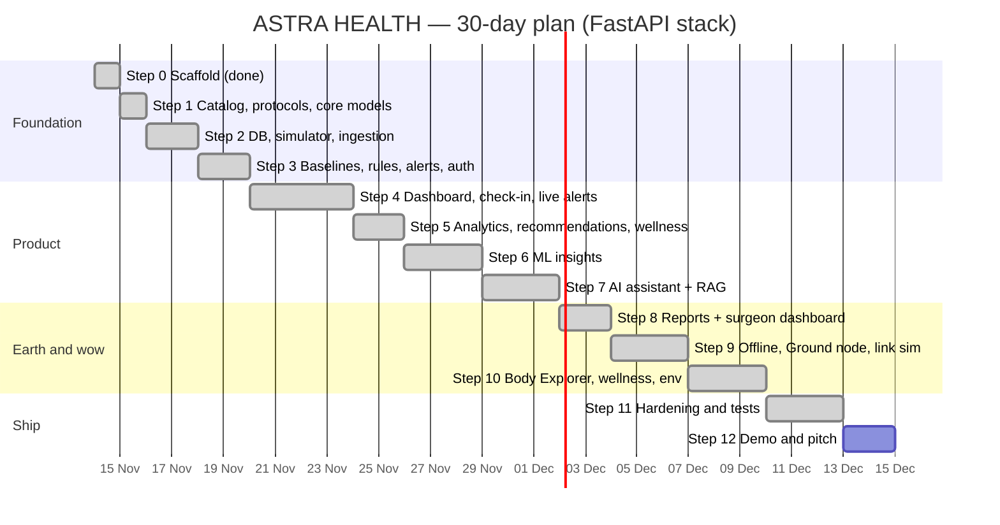

# ASTRA HEALTH — Step-by-Step Implementation Plan

**Version:** 1.1 (React + single FastAPI backend) · **Date:** 2026-11-14 · **Horizon:** 30 days (see §6 cut-lines)
**Design references:** [TDD](01-Technical-Design-Document.md) · [HLD](02-High-Level-Design.md) · [LLD](03-Low-Level-Design.md)

**Stack:** React 19 + Vite + TypeScript + Tailwind (web) · Python 3.12 + FastAPI + SQLModel/SQLite + scikit-learn + Anthropic SDK (backend) · FastAPI WebSockets (real-time). Why this stack: TDD ADR-13.

---

## 1. The build philosophy (read this once)

1. **Build the brain first, then the face.** The heart of ASTRA HEALTH is *simulated data → validation → personal baseline → rules → explainable alert*. That's pure Python in `astra.core` that you can unit-test on Day 2 without any UI. Every screen afterwards just displays it.
2. **Vertical slices, not layers.** Each step below ends with something that works end-to-end and could be demoed. You find integration problems on Day 9, not Day 25.
3. **Simulated data from Day 1.** Analytics need history. The simulator is the foundation of every test and of the demo.
4. **Always have a demoable build.** Tag each milestone (`git tag m1-health-brain`). If Day 30 goes wrong, you present the last tag.
5. **Keep `astra.core` pure.** No FastAPI, database or network imports there. This is what keeps the safety logic testable and trustworthy.
6. **Safety language everywhere.** "Illustrative thresholds", "SIMULATED", "not a diagnosis", from the first screen.

---

## 2. Milestones at a glance

| Milestone | Day | What you can demo |
|---|---|---|
| **M0 — Repo ready** ✅ | 1 | Monorepo scaffolded: FastAPI backend + React shell run together; tests pass |
| **M1 — Health brain** ✅ | 6 | 120 days of simulated crew data in SQLite; baselines + rules produce the right alerts in unit/scenario tests; Swagger UI shows them |
| **M2 — Walking skeleton** ✅ | 10 | Log in as astronaut → Overview → do a check-in → alert appears live (WebSocket) with explanation |
| **M3 — Insightful** | 15 | Analytics charts with baseline bands; recommendations; ML anomaly/trend insights |
| **M4 — Assistant** | 18 | Chat with citations; red-flag emergency card; works with *and* without internet |
| **M5 — Earth link** | 23 | Surgeon dashboard on the Ground node; blackout + delay; reports arrive late but exactly once; instructions flow back |
| **M6 — Wow layer** | 26 | Body Explorer (3D), Wellness Center, radiation & environment panel |
| **M7 — Demo-ready** | 30 | Hardened, scenario-tested, rehearsed 5-minute demo, backup video, README |



---

## 3. Step-by-step plan

Each step: **Goal → Tasks → Done when.** File paths refer to the LLD §1 layout (`services/backend/astra/...`, `apps/web/src/...`).

---

### Step 0 — Scaffold ✅ (done on Day 1)

Already in the repo:
- `services/backend/`: FastAPI app `astra` with `/api/system/status`, `/health`, the `/ws` WebSocket hub, settings via `ASTRA_*` env vars, `astra.core.enums`, pytest suite (incl. the "core stays pure" test).
- `apps/web/`: React + Vite + Tailwind shell, 7-section navigation, live node-status pill, SIMULATED badge; Vite proxies `/api` and `/ws` to the backend.
- `protocols/`, `simulator/scenarios/crew.yaml`, `knowledge/`, CI workflow, PDF generator for docs.

Also done: `services/backend/.env` (git-ignored) with a random `ASTRA_JWT_SECRET` and empty slots for `ASTRA_NASA_API_KEY` and `ANTHROPIC_API_KEY`; `.env.example` is the committed template.

**Your remaining Day-1 tasks:**
- Get a free NASA API key at https://api.nasa.gov/ ("Generate API Key"). Paste it into `ASTRA_NASA_API_KEY` in `services/backend/.env`.
- Make the first commit, create the GitHub repo and push (CI runs automatically). Check that `.env` is not staged.
- Agree on team ownership (§4).

---

### Step 1 — Indicator catalog, protocols and core models (Day 2) ✅

**Goal:** encode the medical "knowledge" as data, with typed loaders, before writing logic.

**Tasks**
- [x] `protocols/indicators.json` — the indicators in LLD §2 (units, conversions, plausible ranges, σ floors).
- [x] `protocols/rules/*.json` — start with **6 rules**: `CV-RHR-BASELINE`, `TH-FEVER`, `TH-FEVER-HIGH`, `SLP-DEFICIT`, `BEH-FATIGUE-COMPOSITE`, `RAD-SPE-EVENT`.
- [x] `protocols/recommendations.json` (~15 entries) and `protocols/emergency/EMG-*.md` (chest pain, syncope, fever, radiation shelter, behavioral crisis — marked illustrative).
- [x] `astra/core/indicators.py`: Pydantic models + loader + `to_canonical(value, unit)`.
- [x] `astra/core/rules/models.py` + `loader.py`: the rule DSL as Pydantic models (LLD §6.4); startup validation of unknown indicators, ops and recommendation codes.
- [x] Load everything in the app's `lifespan` and expose counts on `/health`.
- [x] Tests: T-V-01, T-V-02 (unit conversion), T-R-07 (bad rule file fails).

**Done when:** `pytest` passes and `/health` shows `"indicators": 22, "rules": 6, "recommendations": 15, "emergencyProtocols": 5`. **Done 2026-11-14: 45 backend tests pass; ruff and strict mypy clean.**

---

### Step 2 — Database, simulator, ingestion API (Days 3–4) ✅

**Goal:** realistic history in a real database through the real API.

**Tasks**
- [x] `astra/db/models.py`: SQLModel tables for Users, Missions, Astronauts, HealthMeasurements, WellnessCheckins, Symptoms, HealthBaselines, HealthAlerts, Recommendations, AuditLog, SyncOutbox (LLD §3). `astra/db/session.py` with a `get_session` dependency.
- [ ] *Deferred to before Step 9:* Alembic migrations. Step 2 uses `SQLModel.metadata.create_all` (tables are created at startup).
- [x] Seed command (`python -m astra.seed`): mission ARES-1, AST-001/002/003, users `ast1/ast2/ast3`, `surgeon1`, `mission1`, `admin` (demo passwords in `seed.example.json`, the real file git-ignored).
- [x] `astra/core/validation.py` (LLD §4) + tests T-V-03..05.
- [x] Routers: `POST /api/measurements/batch`, `GET /api/astronauts/{id}/measurements?bucket=day` (pandas resampling for buckets).
- [x] `simulator/simulate.py seed`: 30 pre-flight + 120 mission days for 3 crew from `crew.yaml` (AR(1) noise + scenario effects), posted in batches with `X-Backfill: true`.
- [x] Calibrate the simulator with the published values in LLD §20.4: sleep, bone-loss drift, Mars-surface radiation ≈ 0.64 mSv/day with a ≈ 30 % neutron share. Note each source in `crew.yaml` comments.
- [x] Save real-data fixtures once (using your NASA key): `simulator/fixtures/donki-sep-2024-05.json` (May 2024 storm) and `horizons-mars-2026-07-to-11.json`. The simulator uses the SEP onset times for the `spe_radiation` scenario instead of a made-up day.

**Done when:** `python simulator/simulate.py seed` loads ~150 days × 3 crew, and Swagger UI (`/docs`) shows AST-001's resting-HR series rising from day 114. **Done 2026-11-14:** 6,649 readings (6,648 accepted, 1 questionable sensor glitch); a re-run stores nothing new; AST-001 resting HR goes 66 → 92 bpm from day 114 to 120. 74 backend tests pass.

---

### Step 3 — Baselines, rule engine, alerts, auth (Days 5–6) → **M1** ✅

**Goal:** the health brain works and is proven by tests.

**Tasks**
- [x] `astra/core/baselines.py` (robust median/MAD, floors, exclusions, pre-flight fallback) + tests T-B-01..04.
- [x] `astra/core/rules/engine.py` — `evaluate(rules, ctx)` pure function + an in-memory `EvaluationContext` for tests; tests T-R-01..05 (incl. T-R-03, the "same 85 bpm, different astronaut" case). T-R-06 (sensor glitch) is a scenario test.
- [x] `astra/core/alerts.py` (state machine, merge order) + `astra/services/alerts.py` (dedupe, escalation, auto-resolve, audit, outbox) + tests T-A-01..03.
- [x] Recommendation tasks created with each alert (in `astra/services/alerts.py`) and closed when the alert is resolved.
- [x] `astra/services/assessment.py` + ingestion: save → evaluate rules on the updated history (once per day for backfill) → alerts → tasks → baselines stored → audit → outbox; the router publishes WebSocket events.
- [x] Routers: `GET /api/astronauts/{id}/dashboard`, `GET /api/astronauts/{id}/alerts`, `GET /api/alerts/{id}`, plus `acknowledge` (astronaut) and `review` / `resolve` / `dismiss` (flight surgeon).
- [x] Auth: `POST /api/auth/login` + `GET /api/me` (PyJWT + bcrypt), `astra/security/deps.py` (`current_user`, `require_role`, `viewable_astronaut`), WebSocket requires `?token=`; test T-SEC-01.
- [x] **Scenario tests** (`tests/scenarios/`): the full ARES-1 mission and a healthy crew run through the real intake + assessment (T-R-04, T-R-06, T-SC-01).
- [x] Simulator CLI signs in (admin to post, flight surgeon to close past episodes before day 113).

**Done when:** scenario tests are green; Swagger shows AST-001 with a YELLOW `BEH-FATIGUE-COMPOSITE` alert and full evidence, and AST-002 GREEN. **Done 2026-11-14:**
- **Tests:** 119 backend tests pass in about 15 s; ruff and strict mypy are clean.
- **Live:** AST-001 is YELLOW with sleep deficit (from day 111), heart rate (day 116) and the fatigue pattern (day 117; reason: *4.4 h sleep vs 6.1 h normal, 92 bpm vs 64, fatigue 9/10*). AST-002 and AST-003 are GREEN.
- **Storm:** the real May 2024 storm raised an Urgent alert for all crew on days 87–91.
- **Healthy crew:** 1, 1 and 2 Attention alerts per astronaut (within the budget of 2).
- **Finding:** resting-HR σ_min raised 2 → 3 bpm to stop false alarms (LLD §5.4).

**Tag `m1-health-brain`.**

### Step 4 — Web: login, Overview, check-in, alerts, live updates (Days 7–10) → **M2** ✅

**Tasks**
- [x] Typed API client: `python -m astra.export_openapi ../../apps/web/openapi.json` then `npm run gen:api` (openapi-typescript via `npx`, because the project is on TypeScript 7 and the generator still declares TS 5) + `openapi-fetch` with an auth middleware.
- [x] Login page (demo-account shortcuts), Zustand auth store (persisted, falls back to memory), role guards: `/astronaut/*` for astronauts, `/staff/*` for flight surgeon / mission control / admin.
- [x] App chrome: mission code, mission day and Sol, SIMULATED badge, node + live-socket pill, sign out.
- [x] **Overview**: status header (GREEN / YELLOW / RED with icon + text), urgent banner, `VitalCard`s with "vs your normal" chips, active alerts, today's tasks (tick to complete).
- [x] **Check-in wizard** (sleep → how you feel → optional vitals → review; big sliders; 60 s timer) → `POST /api/checkins` (new backend router; scores + vitals become readings and are assessed at once) → result screen with new findings.
- [x] **Alerts Center**: Active / History tabs, expandable cards with the evidence table, emergency procedure, recommended actions checklist, Acknowledge; `?id=` deep links.
- [x] `src/lib/realtime.ts`: WebSocket `/ws?token=…`, exponential back-off reconnect, 25 s ping; events refresh the TanStack Query caches and raise toasts.
- [x] Backend: `POST /api/checkins`, `POST /api/tasks/{id}/complete`, `GET /api/catalog/indicators`, mission info in `/api/me`; `astra.seed --mission-day-today N`; the simulator loads history up to yesterday and closes all past episodes so today's check-in raises alerts live.
- [x] Minimal staff crew page (status per astronaut, read-only overview for the flight surgeon) so non-astronaut roles don't hit a dead end; the full surgeon dashboard is Step 8.

**Done when:** as `ast1` you finish a check-in in < 60 s and watch the YELLOW alert appear without refreshing. **Done 2026-11-14 (browser):**
- **Check-in:** completed in 38 s (sleep 4.5 h, mood 3, stress 8, fatigue 8, resting HR 91). It raised three new findings live: the fatigue pattern, resting heart rate +9.0σ, and sleep deficit.
- **Live update:** a second, never-reloaded Overview tab switched from *All clear* to *Attention · 3 alert(s)* through the WebSocket.
- **Alert detail:** shows the full evidence table.
- **Checks:** 125 backend tests pass; `tsc`, `vite build` and `oxlint` are clean.
- **Not covered in the browser:** the Acknowledge click wasn't exercised there (it is covered by API tests), and there are no frontend unit tests yet (Step 11).

**Tag `m2-walking-skeleton`.** From here on you always have a demo.

**Demo on any date:** use a fresh database, then:
```
python -m astra.seed --mission-day-today 121
simulator/simulate.py seed
```
Today is mission day 121; the history covers days −29…120.

### Step 5 — Analytics, wellness index, full rule set (Days 11–12) ✅

**Tasks**
- [x] **Health Analytics** page: *Compare vs your normal* (two indicators as σ from their own normal on one axis, default sleep vs resting HR) and *Single indicator* (`BaselineChart`: personal band, pre-flight line, alert periods, hollow flagged readings); 7 days / 30 days / mission; table view; wellness trend. Backend `GET /api/astronauts/{id}/analytics` and `/wellness`.
- [x] `astra/core/wellness.py` (LLD §9) + tests; daily `WellnessScore` stored at every assessment; ring + domain bars on Overview.
- [x] Routine tasks (`astra/services/routine.py`): check-in reminder, hydration, exercise when behind target; asyncio scheduler in `lifespan` (Habitat, every 15 min). *Assessments due* waits for assessment records.
- [x] 10 more rules: `CV-BP-HIGH`, `CV-BP-CRITICAL`, `RS-SPO2-LOW`, `RS-SPO2-CRITICAL`, `MET-GLUCOSE-LOW`, `MET-GLUCOSE-OUT`, `MSK-EXERCISE-ADHERENCE`, `MSK-STRENGTH-DECLINE`, `RAD-CUMULATIVE`, `IMM-STRESS-FEVER` (16 total, + 3 emergency procedures, + 6 recommendations), each with a positive and a negative test. `ENV-*` → Step 10, `SANS-VISION-SYMPTOM` → Step 7 (both need inputs that don't exist yet).

**Done when:** one chart shows sleep falling below its band while resting HR rises above its band. **Done 2026-11-14:**
- **The data:** from day 116 (9 Nov), AST-001's sleep is 4.0–5.2 h against a band of 5.2–7.3 h (−2.9σ to −4.8σ), while resting HR is 75–92 bpm against 58–70 (+3.7σ to +9.3σ).
- **The page:** in the browser, all 4 Analytics charts render. The compare chart has both series, the ±2σ band and the end labels; the single charts have alert markers and pre-flight lines; the wellness chart has both cap lines.
- **Checks:** 158 backend tests pass; ruff, mypy, `tsc`, `vite build` and `oxlint` are clean.
- **Healthy-crew false alarms:** still 1 / 1 / 2.
- **Not covered:** a visual screenshot of the charts (the browser window was minimized; the structure was checked through the DOM).

### Step 6 — ML insights (Days 13–15) → **M3** ✅

**Tasks**
- [x] `astra/ml/features.py` (daily vectors of robust z-scores; recovery strain), `isolation.py` (per-astronaut Isolation Forest, retrained weekly, versioned by a hash of its training days, joblib in `models/`), `trend.py` (Mann–Kendall + Theil–Sen on recovery strain).
- [x] `Insight` table; ML runs **inside the assessment**, before the rules, guarded by try/except and a 10 s budget (LLD §10.4 explains why this replaced `BackgroundTasks`).
- [x] Rule `ML-ANOMALY-CORROBORATED` (Attention only): anomaly ≥ 0.6 **and** rising recovery strain **and** a reading ≥ 2σ out. `op: insight` leaves name `ml_anomaly` / `ml_trend`; the loader refuses them in Urgent rules.
- [x] UI: "AI insights · last 7 days" on Overview; "What the AI noticed" in the alert detail; ML evidence rows named "AI anomaly score" / "Recovery strain trend". API `GET /api/astronauts/{id}/insights`, `insights` in the alert detail.
- [x] Tests: T-ML-01 (day 116 scores above the training 95th percentile), T-ML-02 (ML raises → API still 201, alerts still raised), ML unit tests, rule cases, scenario tests.

**Done when:** the fatigue scenario shows a trend insight about a day before the rule alert. **Done 2026-11-14:**
- **Trend insight on day 115** (AST-001: "Sleep, heart rate and how you feel drifted away from your normal together over 10 days…", p = 0.03). The resting-HR alert follows on day 116 and the fatigue composite on day 117.
- **Healthy crew:** 0 trend insights, 0 ML alerts; false alarms still 1 / 1 / 2.
- **Checks:** 178 backend tests pass; ruff, mypy, `tsc`, `vite build` and `oxlint` are clean. A full mission replay takes about 30 s with the ML.
- **In the browser:** the Overview shows the insights with their contributor chips; the ML alert's detail shows the ML evidence rows and five related insights.
- **Tuning findings** (recorded in LLD §10):
  - Per-indicator trends fired 5–40 false episodes per healthy astronaut, so the trend runs on a combined recovery-strain score instead.
  - Isolation Forest scores level off around 0.6–0.7 even for 9σ days, so the anomaly score only corroborates.
- **Not covered:** a visual screenshot (the browser pane could not draw; the page was checked through its DOM text).

**Tag `m3-insightful`.**

---

### Step 7 — AI Health Assistant with RAG and safety router (Days 16–18) → **M4** ✅

**Tasks**
- [x] Knowledge base: 29 notes (91 sections) in our own words from the 5 hackathon-provided pages: one per hazard, the relevant NASA risks, countermeasures, the CSA neutron-radiation article and how the app judges readings. Every note cites only those URLs (checked by a test).
- [x] `astra/assistant/knowledge.py`: heading-based chunks + BM25 (`rank_bm25`), built at startup. It weights note titles double, ignores words every question shares ("Mars", "astronaut"…) and maps everyday words to the notes' terms ("lonely" → isolation).
- [x] `protocols/redflags.yaml` + `redflag.py` (T-AI-01). It handles negations ("no chest pain") and hypothetical questions (protocol shown, no alert), unless the person is clearly reporting it now. Two new procedures: `EMG-NEURO-SYMPTOMS`, `EMG-SEVERE-BLEEDING` (10 in total).
- [x] Providers: `template.py` (works with no key) and `claude.py`.
  - `claude.py` uses the official `anthropic` SDK with model `ASTRA_LLM_MODEL` (default `claude-opus-5-5`), structured JSON output, effort `low` and the server-side refusal fallback.
  - A refusal, a cut-off answer or an API error falls back to the template.
  - `ollama.py` is **not built** (stretch).
- [x] `guard.py`: no doses, medication instructions or diagnoses; only retrieved citations; escalation line; a fixed "ask the CMO" line for any medication question (T-AI-02..04).
- [x] API:
  - `POST /api/assistant/chat` builds findings from the dashboard and recent insights, answers, stores `ChatMessage`s and audits without the question text.
  - A red-flag *report* from an astronaut creates a `Symptom` and an Urgent `SYM-*` alert, pushed live.
  - Also `GET /api/assistant/history` and `/status`.
- [x] Chat UI: suggested questions, citation chips linking to the source page, provider badge ("Onboard · offline" / "Earth relay · Claude" / "Emergency · no AI"), `EmergencyProtocolCard`. The 10 emergency procedures are bundled into the web app at build time, so they open even when the backend is down.

**Done when:** the same question answers via Claude with a key set and via the template without one, and "I have chest pain" instantly shows the emergency card and creates an Urgent alert. **Done 2026-11-15:**
- **Chest pain (in the browser):**
  - "I have chest pain" shows the chest-pain procedure at once, with no AI call.
  - The Urgent alert `SYM-CHEST-PAIN` appears in the Alerts Center with its evidence, procedure and "contact the CMO" task.
  - The Overview turns RED.
- **Template (live and in the browser):** "Why is my resting heart rate increasing?" answers with "Your resting heart rate is 92 bpm; your personal normal is 64 bpm, so this is 9.3σ above your normal", the AI insight and the fatigue-recovery note, with citations.
- **Claude:** the same question goes through the Claude provider in an API test, using a mocked SDK client; it gets the same citations and history, and Claude is chosen whenever a key is configured. **Not run against the real Claude API:** no `ANTHROPIC_API_KEY` is set on this machine. Add one to `services/backend/.env` and restart to try it.
- **Checks:** 222 backend tests pass (44 assistant tests); ruff, mypy, `tsc`, `vite build` and `oxlint` are clean.
- **Not covered:** a visual screenshot (the browser pane could not draw; the pages were checked through their DOM text). Symptom intake outside the chat (a symptom form, and `SANS-VISION-SYMPTOM`) is not built yet.

**Tag `m4-assistant`.**

---

### Step 8 — Medical reports & Flight Surgeon dashboard (Days 19–20) ✅

**Tasks**
- [x] `astra/services/reports.py`:
  - Daily, weekly, alert-triggered and on-demand reports. Each has a `SummaryJson` (values vs the personal normal, alerts, AI insights, wellness, adherence, radiation, red-flag symptoms, instructions) and a narrative.
  - The narrative comes from Claude when a key is set (facts from the summary only, guarded like chat), else from a deterministic template.
  - Automatic reports come from the 15-minute routine loop and are idempotent: yesterday's daily, the last complete Mon–Sun week, and one per active Urgent or escalated alert.
  - Every report is queued in the sync outbox; alert reports for Urgent alerts get priority 1.
- [x] Reports page (astronaut 07, and the surgeon's Reports tab): list with a Queued/Sent/Delivered chip, the report view (summary, readings-vs-normal table, alerts, wellness, adherence, radiation, AI insights), "New (last 7 days)", and **Print / PDF** with a print stylesheet that prints only the report. Statuses stay *Queued* until the deep-space link exists (Step 9).
- [x] Surgeon routes:
  - **Crew grid** (`GET /api/crew/summary`): status, live wellness index, alert counts, top alert, alerts awaiting review, unacknowledged instructions, latest report and "data as of". Mission control sees status, counts and data time only.
  - **Astronaut detail** with tabs: Summary, Alerts review, Trends, Reports, Instructions.
  - **Alert review**: Start review / Resolve / Dismiss with a note, plus "send an instruction about this alert".
  - **Send instruction** (`POST /api/instructions`), pushed live to the astronaut (`InstructionReceived`). It appears as a banner and toast on their Overview; they acknowledge it, and the surgeon gets a live toast.
- [x] Audit entries for surgeon reads: `SurgeonRead` for any astronaut data read (once per 10 minutes per surgeon, astronaut and kind of data, so the grid's refreshes don't flood the log). `ReportRead`, `ReportGenerated`, `InstructionSent` and `InstructionAcknowledged` are also audited. (The surgeon UI still talks to the Habitat node; Step 9 moves it.)

**Done when:** the surgeon reviews the fatigue alert, reads the report, sends an instruction, and the astronaut sees it live. **Done 2026-11-15** (live demo data, mission day 121):
1. The astronaut's check-in (sleep 4.5 h, resting HR 91, fatigue 8) raised the fatigue-pattern, resting-HR, sleep-deficit and ML-corroborated alerts. The crew grid turned AST-001 to Attention, with "3 alert(s) awaiting your review".
2. The surgeon started review of the fatigue alert (In review).
3. The surgeon generated and read a report: "resting heart rate 83 bpm vs normal 64 (+5.3σ, latest 91); sleep duration 4.5 h vs normal 6.2 (−3.1σ)…; AI insights: rising recovery strain on 6 day(s) from 2026-11-09".
4. The surgeon sent an instruction about the alert.
5. The astronaut's Overview, open in the browser and never reloaded, showed "Message from Flight Surgeon (demo)" as a banner and a toast. Acknowledging it updated the surgeon's Instructions tab to "acknowledged".

- **Checks:** 228 backend tests pass; ruff, mypy, `tsc`, `vite build` and `oxlint` are clean.
- **Not covered:**
  - Visual screenshots (the browser pane could not draw; the pages were checked through their DOM text).
  - The Claude-written narrative ran only with a mocked SDK client (no key on this machine).
  - The printed PDF layout was not inspected.

---

### Step 9 — Offline-first: PWA, Ground node, deep-space link (Days 21–23) → **M5** ✅

**Tasks**
- [x] `vite-plugin-pwa` 2.0: app shell precached (12 files, ≈ 1 MB, including the bundled emergency procedures); manifest; installable. The service worker exists in production builds only (`npm run build && npm run preview`).
- [x] Offline reads and writes (LLD §12.6):
  - `persistQueryClient` keeps the last screens on the device for 24 h; they are cleared on sign-out or user change.
  - A Dexie outbox holds check-ins (sent later with the same client id, so never stored twice), tied to the user who made them.
  - An "Offline — showing data saved on this device at 07:42" banner, with a count of items waiting to be sent.
  - Test T-UI-02 is **not automated yet** (no frontend test runner until Step 11).
- [x] The backend runs a second time as the **Ground** node (`ASTRA_NODE_ROLE=Ground`, port 8001, `ground.db`).
  - Seeded ids are stable (UUIDv5 from codes and usernames), so both nodes agree and a token from one works on the other.
  - The Ground node refuses readings and check-ins (409).
- [x] `astra/sync/` (envelope, link, merge, engine):
  - Outbox on every syncable change: measurements, alerts, reports, instructions, ML insights, space weather.
  - A sync loop every 2 s on both nodes.
  - Receiver `POST /node/sync/envelopes`, HMAC-signed with `ASTRA_SYNC_KEY`; `SyncInbox` by envelope id makes a re-sent envelope a no-op.
  - Delayed ACKs (`/node/sync/acks`), and a retry after 2 × delay + 30 s.
- [x] Link simulation (`astra/sync/link.py`, `LinkState` on the Habitat): Up/Down and delay × compression (2 s per light-minute), controlled by `GET/PUT /api/admin/link`. The Habitat stamps the arrival time on what it sends and refuses (503) Ground traffic while the link is Down.
  - **Simplified:** no blackout schedule or drop/duplicate rates. Duplicates and lost ACKs are covered by tests instead.
- [x] Alert merge by state order (Open < Acknowledged < InReview < Resolved/Dismissed; trigger fields follow the newest trigger).
  - Instructions flow Ground → Habitat; the Habitat reports the delivery time back; acknowledgements flow back too.
  - Reports become Sent → Delivered.
  - Tests T-S-01..03 and T-A-03 (`tests/sync/test_sync.py`: two real apps in-process, simulated time).
- [x] `astra/integrations/`:
  - DONKI (`nasa_donki.py`) and Horizons (`horizons.py`) were already built.
  - New `SpaceWeatherEvent` table and `services/space_weather.py`: the Ground node fetches DONKI SEP events every hour (needs `ASTRA_NASA_API_KEY`), stores new ones and queues them for the Habitat. Live check: the key works; 0 SEP events in the last 30 days.
  - **Not built:** `noaa_swpc.py` (proton flux) and a habitat-side display of the notices (Step 10, environment & radiation).
- [x] Link delay defaults to the real JPL Horizons Earth–Mars light time for today, from the cached table: 11.0 min on 2026-11-14, i.e. 22 s in demo time.
- [x] **Demo Control Panel** (`/staff/sim`, Admin), with:
  - link UP/DOWN;
  - the real Horizons delay plus a manual override slider and "use today's real light time";
  - both queues (waiting / in flight / delivered, last received / last ACK);
  - "inject fatigue episode" and "replay May 2024 solar storm peak" (through the normal intake, so they raise alerts and reports and sync).
  - **Not built:** a mission-day control and a reset button (the panel shows the rebuild commands).
- [x] Surgeon and mission-control routes use the Ground node:
  - Vite proxies `/ground-api` and `/ground-ws` to :8001; the API client rewrites `/api` for those roles.
  - Earth-copy banner: light-time delay, last received, "link DOWN — newer onboard data is waiting".
  - Link pill in the header: "Earth link UP · 11.0 light-min · N queued".
- [x] New live alerts (check-in, wearable readings, scenarios) produce one AlertTriggered report at once, so the report travels with the alerts.

**Done when:** with the link DOWN a check-in raises an alert onboard and the surgeon sees nothing; flip the link UP → after the simulated delay the alert and report appear on Ground exactly once; the surgeon's instruction arrives onboard after the return delay. **Done 2026-11-15** (two live nodes, browser + API):
1. **Link down:** the check-in raised 4 alerts onboard (fatigue pattern, resting HR, sleep deficit, ML-corroborated). The surgeon's crew grid on Earth still showed AST-001 "All clear", under "Link DOWN — newer onboard data is waiting".
2. **Link up:** the 4 alerts and the AlertTriggered report (Delivered) appeared on Ground **24.4 s** later (22 s light time + ≤ 2 s loop). The surgeon's open grid switched to Attention live.
3. **Parity:** both nodes hold 14 alerts and 6,655 readings, with no duplicates; all 7 reports are Delivered on both. The ≈ 6,650 history readings crossed in ≈ 30 s.
4. **Return path:** the surgeon's In Review reached the Habitat, and the instruction arrived onboard ≈ 23 s after sending. A second instruction appeared on the astronaut's open Overview, without a reload, 24 s after sending; until then Earth showed it as not yet delivered.
5. **Checks:** 234 backend tests pass (6 new sync tests); ruff, mypy, `tsc`, `vite build` and `oxlint` are clean.

**Not covered:**
- Offline behaviour was not exercised in the browser (stopping the Habitat server mid-check-in), and there is no automated T-UI-02.
- The service worker was not tested in a production preview.
- No visual screenshots: pages were checked through their DOM text.
- `npm install` reported audit warnings in the PWA build tooling; left as is.

**Tag `m5-earth-link`.**

---

### Step 10 — Body Explorer, Wellness Center, environment & radiation (Days 24–26) → **M6** ✅

**Tasks**
- [x] `GET /api/astronauts/{id}/body-systems` (`astra/services/body.py`, LLD §15.3), with 9 regions: brain, eyes (SANS), heart, lungs, digestive, immune, muscles, bones, whole body (radiation). Each region has:
  - its readings vs the personal normal, with a 14-day sparkline;
  - active alerts whose rules read its indicators (red-flag symptom alerts mapped by type);
  - the pending tasks of those alerts;
  - "what changes in space" and "what you can do" from the knowledge base, with the source;
  - a status: RED Urgent / YELLOW Attention or ≥ 2σ / GREEN / GREY no data.
- [x] **BodyMap2D** (SVG, keyboard-accessible regions) → `RegionPanel` (readings, sparkline with the ±2σ normal band, alerts linking to the Alerts Center, next steps, knowledge).
- [x] **BodyModel3D** (React Three Fiber 9.8 + drei 10.7, three 0.187): a stylised body built from primitives, so there is no external model licence to track.
  - Meshes per region, coloured by status, with hover and click; drag to rotate.
  - A 2D/3D toggle; lazy-loaded (≈ 0.9 MB chunk, only in the 3D view).
- [x] **Wellness Center** (`GET /api/astronauts/{id}/wellness-center`, `POST /api/wellness/activity`):
  - box-breathing exercise (logged when finished);
  - hydration tracker (+250/+500 mL; reaching the target ticks off today's hydration task);
  - 7-day fluid and sleep bars;
  - exercise adherence ring vs the mission target, and strength;
  - sleep routine tips;
  - five wellness missions with progress and a check-in streak.
- [x] **Environment & radiation panel** (Body Explorer, astronaut and surgeon):
  - **Cabin air:** an `EnvironmentReading` store (habitat-wide; the simulator posts temperature, humidity and CO₂ every 6 h), `POST /api/environment/readings` and `GET /environment/current`.
  - **Radiation** (`GET /api/astronauts/{id}/radiation`):
    - daily dose per channel (charged vs neutron);
    - mission total vs the 600 mSv limit and the neutron share;
    - a solar-particle-event banner with the shelter protocol;
    - real inputs labelled: "Real NASA DONKI solar particle events, 09–13 May 2024 — replayed on mission day 87" and "Earth–Mars light time today: 11.0 min (JPL Horizons)".
  - **Rules:** `ENV-CO2-HIGH` and `ENV-HEAT-HYDRATION` are now built (19 rules), plus `REC-CABIN-CHECK` (22 recommendations). Cabin readings sync to Earth.
- [x] Ground / mission control **"Space weather now"** card (`GET /api/space-weather/now`, `astra/integrations/noaa_swpc.py`): NOAA GOES ≥ 10 MeV proton flux against the 10 pfu S1 threshold, on a log scale. It is live on the Ground node (refreshed every 15 min) and falls back to a cached sample (labelled) on the Habitat or offline. It also shows recent DONKI SEP events and the light time.
- [ ] Mission timeline (stretch) — **not built**.

**Done when:** clicking the heart shows resting HR vs baseline, the fatigue alert and the reduced-gravity explanation. **Done 2026-11-15** (live demo data, browser):
- **The heart, after a fatigue check-in:**
  - "Resting heart rate 91 bpm · your normal 64 bpm · +9.0σ";
  - the alerts "Fatigue and recovery pattern needs review", "Resting heart rate above your personal normal" and "Unusual pattern confirmed by readings";
  - six next steps;
  - "What changes in space · Heart and blood vessels in reduced gravity — Without normal gravity, body fluids shift toward the head…".
- **Wellness Center:** "+ 500 mL" updated today's total live (0 → 500).
- **Space weather:** the Ground node showed live NOAA flux (0.225 pfu, below S1); the Habitat showed the cached sample, labelled.
- **Cabin history:** 1,440 readings added no false alerts (the same 5 / 2 / 3 history alerts as before).
- **Checks:** 242 backend tests pass (new: body-systems "done when", the CO₂ alert for the crew, radiation channels, space weather, wellness, and the environment rule cases); ruff, mypy, `tsc`, `vite build` and `oxlint` are clean.

**Not covered:**
- The 3D view was mounted but not seen: the browser pane could not draw, so there are no screenshots and pages were checked through their DOM text.
- Live space-weather notices are not shown onboard yet (only the replayed May 2024 storm and stored DONKI events).
- `npm install` reported audit warnings, left as is.

**Tag `m6-wow`.**

---

### Step 11 — Hardening & evaluation (Days 27–28) ✅

- [x] Run the full test catalogue (LLD §19); fix failures. `ruff check`, `ruff format`, `mypy` (strict) clean. New: T-S-03 (tampered envelope), T-EXT-02 (no NASA key), T-EXT-04 (space-weather event reaches the Habitat), restart mid-sync.
- [x] Record prototype metrics: `python -m astra.evaluate` replays the ARES-1 mission and a healthy crew through the real pipeline and writes [`docs/evaluation/EVALUATION.md`](evaluation/EVALUATION.md) + `metrics.json`.
- [x] Edge cases: missing days (sparse baseline, astronaut with no data = GREEN), sensor glitch (Questionable, no alert), unit mix-ups (µSv → mSv, °F → °C; a fraction typed as % and HR in mmHg are rejected), long chats (2,000-character limit, at most 6 history turns sent to Claude), backend restart mid-sync (nothing lost, no duplicates).
- [x] Accessibility pass: axe-core (WCAG 2.1 A/AA) on the login page, all 8 astronaut pages and the crew view: no serious or critical violations. Fixed: Overview had no `<h1>`; the Analytics indicator menus had no name; "button inside a link" replaced by `LinkButton`. Status already uses colour + icon + text.
- [x] Security pass: `.env` and `*.db` git-ignored and `.env.example` empty (tested); every `/api` route needs sign-in (T-SEC-01); CORS limited to the web origin (tested); login rate-limited (5 failures in 5 min → HTTP 429 + `Retry-After` for 5 min); security headers (`nosniff`, `DENY`, `no-referrer`, `Cache-Control: no-store` on health data); warning at start-up if the JWT secret or sync key is still the dev default.
- [x] Playwright e2e for the demo path (`npm run e2e`; own backend on :8100 with a fresh mission database, own Vite on :5174): T-UI-01 demo path, T-UI-02 offline check-in, chest pain → emergency card + Urgent alert, 10 axe scans. CI job `e2e`.
- [x] Performance: dashboard < 1 s with 150 days × 3 crew — measured **47 ms** median (crew summary 270 ms, mission analytics 52 ms); no extra indexes needed.

**Done when:** the test catalogue, the metrics and the e2e demo path all pass. **Done 2026-11-15:**
- **Metrics** (simulated, seed 42): both scenario events detected (fatigue: rule alerts on day 116, trend insight day 115, onset day 114; solar storm: Urgent for 3/3 crew on day 87); median time to detection 1.0 day; the sensor glitch was marked Questionable and raised nothing. Healthy crew over 150 days: 4 Attention alerts in total (1 / 1 / 2), 0 Urgent, 0 trend insights.
- **Checks:** 257 backend tests and 13 browser tests pass; ruff, ruff format, mypy, `tsc`, `oxlint` and `vite build` are clean.

**Not covered:**
- The healthy crew still gets 4 Attention alerts and 20 single-day anomaly insights in 150 days: an acceptable but not zero false-alarm budget for a prototype; thresholds were not tuned to the simulator.
- Metrics come from the simulator, not real crew data; they show the pipeline works, not clinical accuracy.
- Screen-reader testing by hand (NVDA / VoiceOver) was not done; only automated checks.
- The login limiter is in memory per server process.

**Tag `m7-hardened`** (optional).

---

### Step 11b — Human-centred UI redesign ✅

**Goal:** an astronaut who is tired, busy and far from Earth understands their health in seconds. Information first; plain language; nothing decorative; missing data never shown as normal. Details: LLD §15.4–15.5, HLD §7.

- [x] Design system: light clinical tokens (contrast-checked), white header with mission context and link status, task-based side menu (Home, My Health, Daily Check-in, My Guidance, Wellness, Health History, AI Assistant) with badges, phone drawer, skip link, Emergency procedures always in the menu.
- [x] Home: status in words (never an unexplained score), "Something to pay attention to" (what changed · measurement vs normal · what it means · why it matters · what to do · when to get medical help), key measurement cards (normal range, previous reading, source, time, history link), today's tasks with progress.
- [x] Daily Check-in: 8 guided steps with how-to, units, validation, re-measure, explicit "not measured", wearable value, symptoms (red flags → Urgent alert + procedure), review table.
- [x] My Health: body-system list + diagram with the 7-part explanation; Trends with quick views, "What changed" sentences, daily/weekly tables.
- [x] My Guidance and Health alerts; Wellness in four areas; AI Assistant limits; Health History timeline; flight-surgeon crew overview with communication status, follow-ups and table.
- [x] Backend (additive): vitals' previous value, source and quality; check-in symptoms; `GET /catalog/symptoms`, `/timeline`, `/guidance`; a re-sent check-in is a no-op.

**Done when:** every visible control works, every page passes axe, and the demo path still works. **Done 2026-11-15:**
- **Checks:** 265 backend tests (8 new) and 23 browser tests pass, including 16 axe scans with no serious or critical violations, the guided check-in, offline sync, both emergency paths, navigation and the phone drawer. ruff, mypy, `tsc`, `oxlint` and `vite build` are clean.
- **Found and fixed by the checks:** amber on its own tint was 4.39:1 (token darkened to `#9A4507`); slider labels read as "Mood 7 / 10good 1 · very low …" (now just "Mood" with the scale as a description); a resent check-in id hit a primary-key error (now a no-op).

**Not covered:**
- Screen-reader testing by hand and testing on a real tablet were not done; only automated checks and browser emulation.
- Food intake logging has no backend; the page says so instead of showing fake data.
- Explanations are educational text from the knowledge base, not mission-approved medical content; recommendations remain marked "Illustrative".

---

### Step 12 — Demo, pitch, documentation (Days 29–30) → **M7**

- [ ] `start-demo.ps1`: starts Habitat (8000), Ground (8001) and web (5173), then seeds.
- [ ] Rehearse the 5-minute script (§7) at least 5 times; record a backup video.
- [ ] Slides: problem (5 hazards, comms delay, from the organizer sources) → solution → live demo → architecture (HLD diagram) → safety design (rules decide, ML corroborates, LLM explains) → **NASA 17-risk coverage** (TDD §13) → metrics → **Earth benefits** (TDD §14) → roadmap.
- [ ] README with screenshots, how to run, disclaimers, sources, licence credits. Regenerate doc PDFs (`tools/docs-pdf`).
- [ ] **Tag `v1.0-demo`.**

---

## 4. Team split (3–4 people)

With one backend language, the split is by area rather than by runtime:

| Track | Owner | Steps |
|---|---|---|
| **Health brain & backend** (Python) | Person A | 1, 2 (DB/API), 3, 8 (backend), 9 (sync) |
| **Frontend** (React) | Person B | 4, 5 (UI), 8 (UI), 9 (PWA), 10 |
| **Data, ML & assistant** (Python) | Person C | 2 (simulator), 6, 7 |
| **Content, design & pitch** | Person D (or shared) | Knowledge base, protocol texts, UI design, 3D model, slides, video |

Solo? Follow the steps in order and skip Ollama, PostgreSQL, 3D (keep 2D) and the mission timeline.
Daily: 15-minute stand-up, merge to `main` at least once a day, small PRs, CI green.

---

## 5. Commands you'll use every day

First-time setup (from the repo root):

```bash
cd services/backend && uv venv --python 3.12 .venv && uv pip install --python .venv/Scripts/python.exe -e ".[dev]"
```

```bash
cd apps/web && npm install
```

Secrets: if `services/backend/.env` doesn't exist (e.g. on a teammate's machine), copy it from the template and fill in the values. Never commit `.env`.

```bash
cd services/backend && cp .env.example .env
```

Generate a random value for `ASTRA_JWT_SECRET`:

```bash
cd services/backend && .venv/Scripts/python -c "import secrets; print(secrets.token_urlsafe(48))"
```

Run the Habitat backend (Swagger UI at http://localhost:8000/docs):

```bash
cd services/backend && .venv/Scripts/python -m uvicorn astra.main:app --reload --port 8000
```

Run the Ground backend (from Step 9) in a second terminal (PowerShell):

```bash
cd services/backend; $env:ASTRA_NODE_ROLE="Ground"; $env:ASTRA_NODE_ID="GND-MCC"; $env:ASTRA_DATABASE_URL="sqlite:///ground.db"; .venv/Scripts/python -m uvicorn astra.main:app --reload --port 8001
```

Run the web app (http://localhost:5173):

```bash
cd apps/web && npm run dev
```

Tests and checks:

```bash
cd services/backend && .venv/Scripts/python -m pytest
```

```bash
cd services/backend && .venv/Scripts/python -m ruff check astra tests
```

Packages you'll add later: Step 2 `alembic`; Step 3 `pyjwt bcrypt`; Step 4 (web) `openapi-fetch` + dev `openapi-typescript`; Step 9 (web) `vite-plugin-pwa`; Step 10 (web) `three @react-three/fiber @react-three/drei`.

---

## 6. Scope cut-lines (decide quickly when behind)

Cut in this order — the demo story survives every cut:

1. Mission timeline, voice input, wellness streaks
2. Ollama local LLM (the template provider already covers offline)
3. PostgreSQL for Ground (stay on SQLite)
4. 3D body (keep the 2D SVG body map)
5. Live external API calls (replay the cached fixtures only; the demo looks the same)
6. Isolation Forest (keep the trend test; say "ML layer in progress")
7. Separate Ground node (surgeon uses the Habitat node; simulate delay in the UI only)

**Never cut:** simulator, baselines, rule engine with evidence, check-in → alert flow, red-flag emergency card, safety disclaimers.

---

## 7. The 5-minute demo script

| Time | Scene | What judges see |
|---|---|---|
| 0:00 | Problem | "Day 120 on Mars. Earth is 14 light-minutes away and the link is in blackout." Link pill: 🔴 BLACKOUT |
| 0:30 | Morning check-in | Guided check-in: resting HR 96 is flagged as far above normal ("Measure again" / "Keep this value"); sleep 4.5 h, fatigue 8, mood 3; done in ~60 s |
| 1:15 | Detection | YELLOW alert appears live: *Fatigue & recovery pattern needs review*; evidence: sleep −3.1σ, resting HR 89 vs normal 64 |
| 1:45 | Context-aware | Switch to AST-003: the same 85 bpm is GREEN because their normal is 80 |
| 2:00 | Analytics | Sleep falls out of its baseline band while resting HR rises; the ML trend insight flagged it a day earlier |
| 2:30 | Assistant | "Why is my resting heart rate increasing?" → grounded answer citing the NASA sources, badge "Onboard (offline)". Then "I have chest pain" → instant emergency protocol card |
| 3:15 | My Health | Heart and circulation → what it does, how spaceflight affects it, readings vs normal, symptoms to watch for |
| 3:40 | Earth link | Flip the link UP → after the simulated 14-minute delay the report lands on the surgeon dashboard, exactly once |
| 4:10 | Surgeon | Surgeon reviews the evidence and sends an instruction; it arrives onboard after the return delay |
| 4:40 | Close | Rules decide, ML corroborates, LLM explains · offline-first · human in the loop · NASA 17-risk coverage |

---

## 8. Definition of done (every feature)
- [ ] Works with the simulated data and is labelled SIMULATED where data is shown
- [ ] Unit tests for logic in `astra.core`; scenario test if it touches alerts
- [ ] Works offline, or degrades with a clear message
- [ ] Role checks enforced server-side (FastAPI dependency)
- [ ] No "diagnosis" or medication language; illustrative thresholds labelled
- [ ] `ruff` clean, merged to `main`, CI green, demo still runs
