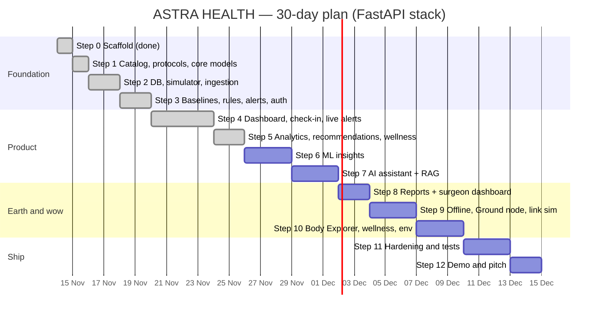

# ASTRA HEALTH — Step-by-Step Implementation Plan

**Version:** 1.1 (React + single FastAPI backend) · **Date:** 2026-11-14 · **Horizon:** 30 days (see §6 cut-lines)
**Design references:** [TDD](01-Technical-Design-Document.md) · [HLD](02-High-Level-Design.md) · [LLD](03-Low-Level-Design.md)

**Stack:** React 19 + Vite + TypeScript + Tailwind (web) · Python 3.12 + FastAPI + SQLModel/SQLite + scikit-learn + Anthropic SDK (backend) · FastAPI WebSockets (real-time). Why this stack: TDD ADR-13.

---

## 1. The build philosophy (read this once)

1. **Build the brain first, then the face.** The heart of ASTRA HEALTH is *simulated data → validation → personal baseline → rules → explainable alert*. That's pure Python in `astra.core` that you can unit-test on Day 2 without any UI. Every screen afterwards just displays it.
2. **Vertical slices, not layers.** Each step below ends with something that works end-to-end and could be demoed. You find integration problems on Day 9, not Day 25.
3. **Simulated data from Day 1.** Analytics need history. The simulator is the foundation of every test and of the demo.
4. **Always have a demoable build.** Tag each milestone (`git tag m1-health-brain`). If Day 30 goes wrong, you present the last tag.
5. **Keep `astra.core` pure.** No FastAPI, database or network imports there. This is what keeps the safety logic testable and trustworthy.
6. **Safety language everywhere.** "Illustrative thresholds", "SIMULATED", "not a diagnosis", from the first screen.

---

## 2. Milestones at a glance

| Milestone | Day | What you can demo |
|---|---|---|
| **M0 — Repo ready** ✅ | 1 | Monorepo scaffolded: FastAPI backend + React shell run together; tests pass |
| **M1 — Health brain** ✅ | 6 | 120 days of simulated crew data in SQLite; baselines + rules produce the right alerts in unit/scenario tests; Swagger UI shows them |
| **M2 — Walking skeleton** ✅ | 10 | Log in as astronaut → Overview → do a check-in → alert appears live (WebSocket) with explanation |
| **M3 — Insightful** | 15 | Analytics charts with baseline bands; recommendations; ML anomaly/trend insights |
| **M4 — Assistant** | 18 | Chat with citations; red-flag emergency card; works with *and* without internet |
| **M5 — Earth link** | 23 | Surgeon dashboard on the Ground node; blackout + delay; reports arrive late but exactly once; instructions flow back |
| **M6 — Wow layer** | 26 | Body Explorer (3D), Wellness Center, radiation & environment panel |
| **M7 — Demo-ready** | 30 | Hardened, scenario-tested, rehearsed 5-minute demo, backup video, README |



---

## 3. Step-by-step plan

Each step: **Goal → Tasks → Done when.** File paths refer to the LLD §1 layout (`services/backend/astra/...`, `apps/web/src/...`).

---

### Step 0 — Scaffold ✅ (done on Day 1)

Already in the repo:
- `services/backend/`: FastAPI app `astra` with `/api/system/status`, `/health`, the `/ws` WebSocket hub, settings via `ASTRA_*` env vars, `astra.core.enums`, pytest suite (incl. the "core stays pure" test).
- `apps/web/`: React + Vite + Tailwind shell, 7-section navigation, live node-status pill, SIMULATED badge; Vite proxies `/api` and `/ws` to the backend.
- `protocols/`, `simulator/scenarios/crew.yaml`, `knowledge/`, CI workflow, PDF generator for docs.

Also done: `services/backend/.env` (git-ignored) with a random `ASTRA_JWT_SECRET` and empty slots for `ASTRA_NASA_API_KEY` and `ANTHROPIC_API_KEY`; `.env.example` is the committed template.

**Your remaining Day-1 tasks:**
- Get a free NASA API key at https://api.nasa.gov/ ("Generate API Key"). Paste it into `ASTRA_NASA_API_KEY` in `services/backend/.env`.
- Make the first commit, create the GitHub repo and push (CI runs automatically). Check that `.env` is not staged.
- Agree on team ownership (§4).

---

### Step 1 — Indicator catalog, protocols and core models (Day 2) ✅

**Goal:** encode the medical "knowledge" as data, with typed loaders, before writing logic.

**Tasks**
- [x] `protocols/indicators.json` — the indicators in LLD §2 (units, conversions, plausible ranges, σ floors).
- [x] `protocols/rules/*.json` — start with **6 rules**: `CV-RHR-BASELINE`, `TH-FEVER`, `TH-FEVER-HIGH`, `SLP-DEFICIT`, `BEH-FATIGUE-COMPOSITE`, `RAD-SPE-EVENT`.
- [x] `protocols/recommendations.json` (~15 entries) and `protocols/emergency/EMG-*.md` (chest pain, syncope, fever, radiation shelter, behavioral crisis — marked illustrative).
- [x] `astra/core/indicators.py`: Pydantic models + loader + `to_canonical(value, unit)`.
- [x] `astra/core/rules/models.py` + `loader.py`: the rule DSL as Pydantic models (LLD §6.4); startup validation of unknown indicators, ops and recommendation codes.
- [x] Load everything in the app's `lifespan` and expose counts on `/health`.
- [x] Tests: T-V-01, T-V-02 (unit conversion), T-R-07 (bad rule file fails).

**Done when:** `pytest` passes and `/health` shows `"indicators": 22, "rules": 6, "recommendations": 15, "emergencyProtocols": 5`. **Done 2026-11-14: 45 backend tests pass; ruff and strict mypy clean.**

---

### Step 2 — Database, simulator, ingestion API (Days 3–4) ✅

**Goal:** realistic history in a real database through the real API.

**Tasks**
- [x] `astra/db/models.py`: SQLModel tables for Users, Missions, Astronauts, HealthMeasurements, WellnessCheckins, Symptoms, HealthBaselines, HealthAlerts, Recommendations, AuditLog, SyncOutbox (LLD §3). `astra/db/session.py` with a `get_session` dependency.
- [ ] *Deferred to before Step 9:* Alembic migrations. Step 2 uses `SQLModel.metadata.create_all` (tables are created at startup).
- [x] Seed command (`python -m astra.seed`): mission ARES-1, AST-001/002/003, users `ast1/ast2/ast3`, `surgeon1`, `mission1`, `admin` (demo passwords in `seed.example.json`, the real file git-ignored).
- [x] `astra/core/validation.py` (LLD §4) + tests T-V-03..05.
- [x] Routers: `POST /api/measurements/batch`, `GET /api/astronauts/{id}/measurements?bucket=day` (pandas resampling for buckets).
- [x] `simulator/simulate.py seed`: 30 pre-flight + 120 mission days for 3 crew from `crew.yaml` (AR(1) noise + scenario effects), posted in batches with `X-Backfill: true`.
- [x] Calibrate the simulator with the published values in LLD §20.4: sleep, bone-loss drift, Mars-surface radiation ≈ 0.64 mSv/day with a ≈ 30 % neutron share. Note each source in `crew.yaml` comments.
- [x] Save real-data fixtures once (using your NASA key): `simulator/fixtures/donki-sep-2024-05.json` (May 2024 storm) and `horizons-mars-2026-07-to-11.json`. The simulator uses the SEP onset times for the `spe_radiation` scenario instead of a made-up day.

**Done when:** `python simulator/simulate.py seed` loads ~150 days × 3 crew, and Swagger UI (`/docs`) shows AST-001's resting-HR series rising from day 114. **Done 2026-11-14:** 6,649 readings (6,648 accepted, 1 questionable sensor glitch); a re-run stores nothing new; AST-001 resting HR goes 66 → 92 bpm from day 114 to 120. 74 backend tests pass.

---

### Step 3 — Baselines, rule engine, alerts, auth (Days 5–6) → **M1** ✅

**Goal:** the health brain works and is proven by tests.

**Tasks**
- [x] `astra/core/baselines.py` (robust median/MAD, floors, exclusions, pre-flight fallback) + tests T-B-01..04.
- [x] `astra/core/rules/engine.py` — `evaluate(rules, ctx)` pure function + an in-memory `EvaluationContext` for tests; tests T-R-01..05 (incl. T-R-03, the "same 85 bpm, different astronaut" case). T-R-06 (sensor glitch) is a scenario test.
- [x] `astra/core/alerts.py` (state machine, merge order) + `astra/services/alerts.py` (dedupe, escalation, auto-resolve, audit, outbox) + tests T-A-01..03.
- [x] Recommendation tasks created with each alert (in `astra/services/alerts.py`) and closed when the alert is resolved.
- [x] `astra/services/assessment.py` + ingestion: save → evaluate rules on the updated history (once per day for backfill) → alerts → tasks → baselines stored → audit → outbox; the router publishes WebSocket events.
- [x] Routers: `GET /api/astronauts/{id}/dashboard`, `GET /api/astronauts/{id}/alerts`, `GET /api/alerts/{id}`, plus `acknowledge` (astronaut) and `review` / `resolve` / `dismiss` (flight surgeon).
- [x] Auth: `POST /api/auth/login` + `GET /api/me` (PyJWT + bcrypt), `astra/security/deps.py` (`current_user`, `require_role`, `viewable_astronaut`), WebSocket requires `?token=`; test T-SEC-01.
- [x] **Scenario tests** (`tests/scenarios/`): the full ARES-1 mission and a healthy crew run through the real intake + assessment (T-R-04, T-R-06, T-SC-01).
- [x] Simulator CLI signs in (admin to post, flight surgeon to close past episodes before day 113).

**Done when:** scenario tests are green; Swagger shows AST-001 with a YELLOW `BEH-FATIGUE-COMPOSITE` alert and full evidence, and AST-002 GREEN. **Done 2026-11-14:**
- **Tests:** 119 backend tests pass in about 15 s; ruff and strict mypy are clean.
- **Live:** AST-001 is YELLOW with sleep deficit (from day 111), heart rate (day 116) and the fatigue pattern (day 117; reason: *4.4 h sleep vs 6.1 h normal, 92 bpm vs 64, fatigue 9/10*). AST-002 and AST-003 are GREEN.
- **Storm:** the real May 2024 storm raised an Urgent alert for all crew on days 87–91.
- **Healthy crew:** 1, 1 and 2 Attention alerts per astronaut (within the budget of 2).
- **Finding:** resting-HR σ_min raised 2 → 3 bpm to stop false alarms (LLD §5.4).

**Tag `m1-health-brain`.**

### Step 4 — Web: login, Overview, check-in, alerts, live updates (Days 7–10) → **M2** ✅

**Tasks**
- [x] Typed API client: `python -m astra.export_openapi ../../apps/web/openapi.json` then `npm run gen:api` (openapi-typescript via `npx`, because the project is on TypeScript 7 and the generator still declares TS 5) + `openapi-fetch` with an auth middleware.
- [x] Login page (demo-account shortcuts), Zustand auth store (persisted, falls back to memory), role guards: `/astronaut/*` for astronauts, `/staff/*` for flight surgeon / mission control / admin.
- [x] App chrome: mission code, mission day and Sol, SIMULATED badge, node + live-socket pill, sign out.
- [x] **Overview**: status header (GREEN / YELLOW / RED with icon + text), urgent banner, `VitalCard`s with "vs your normal" chips, active alerts, today's tasks (tick to complete).
- [x] **Check-in wizard** (sleep → how you feel → optional vitals → review; big sliders; 60 s timer) → `POST /api/checkins` (new backend router; scores + vitals become readings and are assessed at once) → result screen with new findings.
- [x] **Alerts Center**: Active / History tabs, expandable cards with the evidence table, emergency procedure, recommended actions checklist, Acknowledge; `?id=` deep links.
- [x] `src/lib/realtime.ts`: WebSocket `/ws?token=…`, exponential back-off reconnect, 25 s ping; events refresh the TanStack Query caches and raise toasts.
- [x] Backend: `POST /api/checkins`, `POST /api/tasks/{id}/complete`, `GET /api/catalog/indicators`, mission info in `/api/me`; `astra.seed --mission-day-today N`; the simulator loads history up to yesterday and closes all past episodes so today's check-in raises alerts live.
- [x] Minimal staff crew page (status per astronaut, read-only overview for the flight surgeon) so non-astronaut roles don't hit a dead end; the full surgeon dashboard is Step 8.

**Done when:** as `ast1` you finish a check-in in < 60 s and watch the YELLOW alert appear without refreshing. **Done 2026-11-14 (browser):**
- **Check-in:** completed in 38 s (sleep 4.5 h, mood 3, stress 8, fatigue 8, resting HR 91). It raised three new findings live: the fatigue pattern, resting heart rate +9.0σ, and sleep deficit.
- **Live update:** a second, never-reloaded Overview tab switched from *All clear* to *Attention · 3 alert(s)* through the WebSocket.
- **Alert detail:** shows the full evidence table.
- **Checks:** 125 backend tests pass; `tsc`, `vite build` and `oxlint` are clean.
- **Not covered in the browser:** the Acknowledge click wasn't exercised there (it is covered by API tests), and there are no frontend unit tests yet (Step 11).

**Tag `m2-walking-skeleton`.** From here on you always have a demo.

**Demo on any date:** use a fresh database, then:
```
python -m astra.seed --mission-day-today 121
simulator/simulate.py seed
```
Today is mission day 121; the history covers days −29…120.

### Step 5 — Analytics, wellness index, full rule set (Days 11–12) ✅

**Tasks**
- [x] **Health Analytics** page: *Compare vs your normal* (two indicators as σ from their own normal on one axis, default sleep vs resting HR) and *Single indicator* (`BaselineChart`: personal band, pre-flight line, alert periods, hollow flagged readings); 7 days / 30 days / mission; table view; wellness trend. Backend `GET /api/astronauts/{id}/analytics` and `/wellness`.
- [x] `astra/core/wellness.py` (LLD §9) + tests; daily `WellnessScore` stored at every assessment; ring + domain bars on Overview.
- [x] Routine tasks (`astra/services/routine.py`): check-in reminder, hydration, exercise when behind target; asyncio scheduler in `lifespan` (Habitat, every 15 min). *Assessments due* waits for assessment records.
- [x] 10 more rules: `CV-BP-HIGH`, `CV-BP-CRITICAL`, `RS-SPO2-LOW`, `RS-SPO2-CRITICAL`, `MET-GLUCOSE-LOW`, `MET-GLUCOSE-OUT`, `MSK-EXERCISE-ADHERENCE`, `MSK-STRENGTH-DECLINE`, `RAD-CUMULATIVE`, `IMM-STRESS-FEVER` (16 total, + 3 emergency procedures, + 6 recommendations), each with a positive and a negative test. `ENV-*` → Step 10, `SANS-VISION-SYMPTOM` → Step 7 (both need inputs that don't exist yet).

**Done when:** one chart shows sleep falling below its band while resting HR rises above its band. **Done 2026-11-14:**
- **The data:** from day 116 (9 Nov), AST-001's sleep is 4.0–5.2 h against a band of 5.2–7.3 h (−2.9σ to −4.8σ), while resting HR is 75–92 bpm against 58–70 (+3.7σ to +9.3σ).
- **The page:** in the browser, all 4 Analytics charts render. The compare chart has both series, the ±2σ band and the end labels; the single charts have alert markers and pre-flight lines; the wellness chart has both cap lines.
- **Checks:** 158 backend tests pass; ruff, mypy, `tsc`, `vite build` and `oxlint` are clean.
- **Healthy-crew false alarms:** still 1 / 1 / 2.
- **Not covered:** a visual screenshot of the charts (the browser window was minimized; the structure was checked through the DOM).

### Step 6 — ML insights (Days 13–15) → **M3**

**Tasks**
- [ ] `astra/ml/features.py` (daily vectors as robust z-scores), `isolation.py` (train/score per astronaut, joblib in `models/`), `trend.py` (Mann–Kendall + Theil–Sen).
- [ ] `Insights` table; `run_insights(astronaut_id)` scheduled with `BackgroundTasks`, CPU work in `anyio.to_thread.run_sync`, 10 s limit, exceptions logged and swallowed.
- [ ] Rule `ML-ANOMALY-CORROBORATED` (Attention only).
- [ ] UI: "AI insights" on Overview and alert detail ("anomaly score 0.82; top contributors: resting HR, sleep, fatigue").
- [ ] Tests T-ML-01 (fatigue scenario scores high) and T-ML-02 (monkeypatch the ML to raise → API still 201, alerts still raised).

**Done when:** the fatigue scenario shows a trend insight about a day before the rule alert. **Tag `m3-insightful`.**

---

### Step 7 — AI Health Assistant with RAG and safety router (Days 16–18) → **M4**

**Tasks**
- [ ] Knowledge base: ~25 Markdown notes in your own words from the **hackathon-provided sources** (TDD §12.1), one per hazard, one per relevant NASA risk, plus countermeasures and the CSA radiation article (LLD §11.3). Split across the team.
- [ ] `astra/assistant/retriever.py`: heading-based chunking + BM25 (`rank_bm25`), index built at startup.
- [ ] `redflags.yaml` + `redflag.py` + test T-AI-01.
- [ ] Providers: **`template.py` first** (works with no key), then **`claude.py`** (official `anthropic` SDK, model from `ASTRA_LLM_MODEL`, structured JSON output, refusal/error → template), then `ollama.py` (stretch).
- [ ] `guard.py` (dosage/diagnosis filter, citation check, escalation line) + tests T-AI-02..04.
- [ ] Router `POST /api/assistant/chat`: builds findings from the DB, calls `assistant.answer()`, stores `ChatMessages`, audits.
- [ ] Chat UI: suggested questions, citation chips, provider badge ("Onboard · offline" / "Earth relay · Claude"), `EmergencyProtocolCard`; emergency protocols bundled into the web app so they work if the backend is down.

**Done when:** the same question answers via Claude with a key set and via the template without one, and "I have chest pain" instantly shows the emergency card and creates an Urgent alert. **Tag `m4-assistant`.**

---

### Step 8 — Medical reports & Flight Surgeon dashboard (Days 19–20)

**Tasks**
- [ ] `astra/services/reports.py`: daily, weekly, alert-triggered `SummaryJson` + narrative (LLM or template).
- [ ] Reports page with print-to-PDF stylesheet and Queued/Sent/Delivered status.
- [ ] Surgeon routes: **Crew grid** (status, wellness index, alerts, "data as of"), **Astronaut detail** (summary, trends, alerts, reports, instructions), **Alert review** (In Review / Resolve / Dismiss with note), **Send instruction**.
- [ ] Audit entries for surgeon reads. (Surgeon UI still talks to the Habitat node; Step 9 moves it.)

**Done when:** the surgeon reviews the fatigue alert, reads the report, sends an instruction, and the astronaut sees it live.

---

### Step 9 — Offline-first: PWA, Ground node, deep-space link (Days 21–23) → **M5**

**Tasks**
- [ ] `vite-plugin-pwa`: app shell + protocols precached; installable.
- [ ] Dexie outbox for writes + `persistQueryClient` for reads (LLD §12.6); "offline — showing data from 07:42" banner. Test T-UI-02.
- [ ] Run the backend a second time in **Ground** mode (`ASTRA_NODE_ROLE=Ground`, port 8001, `ground.db`).
- [ ] `astra/sync/`: outbox writes on every syncable change; sender loop (asyncio task); receiver `POST /api/sync/envelopes` with HMAC + `SyncInbox` idempotency; delayed ACKs.
- [ ] `astra/sync/link.py`: delay queue, blackouts, compression factor; `PUT /api/admin/link`.
- [ ] Alert merge by state order; instructions flow Ground → Habitat. Tests T-S-01..03, T-A-03.
- [ ] `astra/integrations/` (LLD §20): `nasa_donki.py` (SEP events), `horizons.py` (Earth–Mars light time), `noaa_swpc.py` (proton flux), `fixtures.py` (cache + replay). Runs on the Ground node only; `SpaceWeatherEvents` table; tests T-EXT-01..04.
- [ ] Link delay defaults to the real Horizons light time for the mission date; new SEP events travel to the Habitat as `SpaceWeatherNotice` envelopes (HLD §5.3a).
- [ ] **Demo Control Panel** (`/admin/sim`): link UP/DOWN, delay (real Horizons value, with a manual override slider), queue size, mission day, "inject fatigue scenario", "replay May 2024 solar storm", reset.
- [ ] Point surgeon/mission routes at the Ground node (second Vite proxy prefix, e.g. `/ground-api` → 8001); show staleness.

**Done when:** with the link DOWN a check-in raises an alert onboard and the surgeon sees nothing; flip the link UP → after the simulated delay the alert and report appear on Ground exactly once; the surgeon's instruction arrives onboard after the return delay. **Tag `m5-earth-link`.**

---

### Step 10 — Body Explorer, Wellness Center, environment & radiation (Days 24–26) → **M6**

**Tasks**
- [ ] `GET /api/astronauts/{id}/body-systems` (LLD §15.3 mapping).
- [ ] **BodyMap2D** (SVG) first → `RegionPanel` (metrics, mini charts, alerts, "what changes in space" from the KB, next steps).
- [ ] **BodyModel3D** with React Three Fiber (`three @react-three/fiber @react-three/drei`): a CC0/CC-BY anatomy GLB (check and credit the licence) or a stylised body from primitives; meshes named `region_*`; 2D fallback toggle.
- [ ] **Wellness Center**: breathing exercise, sleep routine, exercise plan + adherence ring, hydration tracker, wellness missions with streaks.
- [ ] **Environment & radiation panel**: cabin temp/humidity/CO₂, daily dose per channel (incl. neutron), cumulative dose vs the 600 mSv limit, solar-particle-event banner → shelter protocol. Label real inputs clearly: "Real NASA DONKI event: 10 May 2024", "Earth–Mars light time: 11.0 min (JPL Horizons)".
- [ ] Ground / Mission Control "Space weather now" card: live NOAA ≥10 MeV proton flux against the 10 pfu S1 threshold.
- [ ] Mission timeline (stretch).

**Done when:** clicking the heart shows resting HR vs baseline, the fatigue alert and the reduced-gravity explanation. **Tag `m6-wow`.**

---

### Step 11 — Hardening & evaluation (Days 27–28)

- [ ] Run the full test catalogue (LLD §19); fix failures. `ruff check`, `mypy astra` clean.
- [ ] Record prototype metrics: detection rate per scenario, false alarms on the healthy crew, median time-to-detection, check-in time, sync duplicates.
- [ ] Edge cases: missing days, sensor glitch, unit mix-ups, long chats, backend restart mid-sync.
- [ ] Accessibility pass (contrast, focus, labels, colour + icon + text).
- [ ] Security pass: no secrets in git, every route has an auth dependency (T-SEC-01), CORS restricted, login rate-limited.
- [ ] Playwright e2e for the demo path.
- [ ] Performance: dashboard < 1 s with 150 days × 3 crew (indexes / daily aggregates if needed).

---

### Step 12 — Demo, pitch, documentation (Days 29–30) → **M7**

- [ ] `start-demo.ps1`: starts Habitat (8000), Ground (8001) and web (5173), then seeds.
- [ ] Rehearse the 5-minute script (§7) at least 5 times; record a backup video.
- [ ] Slides: problem (5 hazards, comms delay, from the organizer sources) → solution → live demo → architecture (HLD diagram) → safety design (rules decide, ML corroborates, LLM explains) → **NASA 17-risk coverage** (TDD §13) → metrics → **Earth benefits** (TDD §14) → roadmap.
- [ ] README with screenshots, how to run, disclaimers, sources, licence credits. Regenerate doc PDFs (`tools/docs-pdf`).
- [ ] **Tag `v1.0-demo`.**

---

## 4. Team split (3–4 people)

With one backend language, the split is by area rather than by runtime:

| Track | Owner | Steps |
|---|---|---|
| **Health brain & backend** (Python) | Person A | 1, 2 (DB/API), 3, 8 (backend), 9 (sync) |
| **Frontend** (React) | Person B | 4, 5 (UI), 8 (UI), 9 (PWA), 10 |
| **Data, ML & assistant** (Python) | Person C | 2 (simulator), 6, 7 |
| **Content, design & pitch** | Person D (or shared) | Knowledge base, protocol texts, UI design, 3D model, slides, video |

Solo? Follow the steps in order and skip Ollama, PostgreSQL, 3D (keep 2D) and the mission timeline.
Daily: 15-minute stand-up, merge to `main` at least once a day, small PRs, CI green.

---

## 5. Commands you'll use every day

First-time setup (from the repo root):

```bash
cd services/backend && uv venv --python 3.12 .venv && uv pip install --python .venv/Scripts/python.exe -e ".[dev]"
```

```bash
cd apps/web && npm install
```

Secrets: if `services/backend/.env` doesn't exist (e.g. on a teammate's machine), copy it from the template and fill in the values. Never commit `.env`.

```bash
cd services/backend && cp .env.example .env
```

Generate a random value for `ASTRA_JWT_SECRET`:

```bash
cd services/backend && .venv/Scripts/python -c "import secrets; print(secrets.token_urlsafe(48))"
```

Run the Habitat backend (Swagger UI at http://localhost:8000/docs):

```bash
cd services/backend && .venv/Scripts/python -m uvicorn astra.main:app --reload --port 8000
```

Run the Ground backend (from Step 9) in a second terminal (PowerShell):

```bash
cd services/backend; $env:ASTRA_NODE_ROLE="Ground"; $env:ASTRA_NODE_ID="GND-MCC"; $env:ASTRA_DATABASE_URL="sqlite:///ground.db"; .venv/Scripts/python -m uvicorn astra.main:app --reload --port 8001
```

Run the web app (http://localhost:5173):

```bash
cd apps/web && npm run dev
```

Tests and checks:

```bash
cd services/backend && .venv/Scripts/python -m pytest
```

```bash
cd services/backend && .venv/Scripts/python -m ruff check astra tests
```

Packages you'll add later: Step 2 `alembic`; Step 3 `pyjwt bcrypt`; Step 4 (web) `openapi-fetch` + dev `openapi-typescript`; Step 9 (web) `vite-plugin-pwa`; Step 10 (web) `three @react-three/fiber @react-three/drei`.

---

## 6. Scope cut-lines (decide quickly when behind)

Cut in this order — the demo story survives every cut:

1. Mission timeline, voice input, wellness streaks
2. Ollama local LLM (the template provider already covers offline)
3. PostgreSQL for Ground (stay on SQLite)
4. 3D body (keep the 2D SVG body map)
5. Live external API calls (replay the cached fixtures only; the demo looks the same)
6. Isolation Forest (keep the trend test; say "ML layer in progress")
7. Separate Ground node (surgeon uses the Habitat node; simulate delay in the UI only)

**Never cut:** simulator, baselines, rule engine with evidence, check-in → alert flow, red-flag emergency card, safety disclaimers.

---

## 7. The 5-minute demo script

| Time | Scene | What judges see |
|---|---|---|
| 0:00 | Problem | "Day 120 on Mars. Earth is 14 light-minutes away and the link is in blackout." Link pill: 🔴 BLACKOUT |
| 0:30 | Morning check-in | Astronaut completes the check-in in ~40 s (sleep 4.5 h, fatigue 8, mood 3) |
| 1:15 | Detection | YELLOW alert appears live: *Fatigue & recovery pattern needs review*; evidence: sleep −3.1σ, resting HR 89 vs normal 64 |
| 1:45 | Context-aware | Switch to AST-003: the same 85 bpm is GREEN because their normal is 80 |
| 2:00 | Analytics | Sleep falls out of its baseline band while resting HR rises; the ML trend insight flagged it a day earlier |
| 2:30 | Assistant | "Why is my resting heart rate increasing?" → grounded answer citing the NASA sources, badge "Onboard (offline)". Then "I have chest pain" → instant emergency protocol card |
| 3:15 | Body Explorer | Click the heart → data, alert, reduced-gravity explanation |
| 3:40 | Earth link | Flip the link UP → after the simulated 14-minute delay the report lands on the surgeon dashboard, exactly once |
| 4:10 | Surgeon | Surgeon reviews the evidence and sends an instruction; it arrives onboard after the return delay |
| 4:40 | Close | Rules decide, ML corroborates, LLM explains · offline-first · human in the loop · NASA 17-risk coverage |

---

## 8. Definition of done (every feature)
- [ ] Works with the simulated data and is labelled SIMULATED where data is shown
- [ ] Unit tests for logic in `astra.core`; scenario test if it touches alerts
- [ ] Works offline, or degrades with a clear message
- [ ] Role checks enforced server-side (FastAPI dependency)
- [ ] No "diagnosis" or medication language; illustrative thresholds labelled
- [ ] `ruff` clean, merged to `main`, CI green, demo still runs
